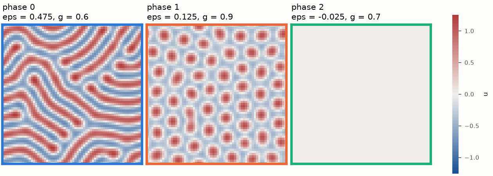
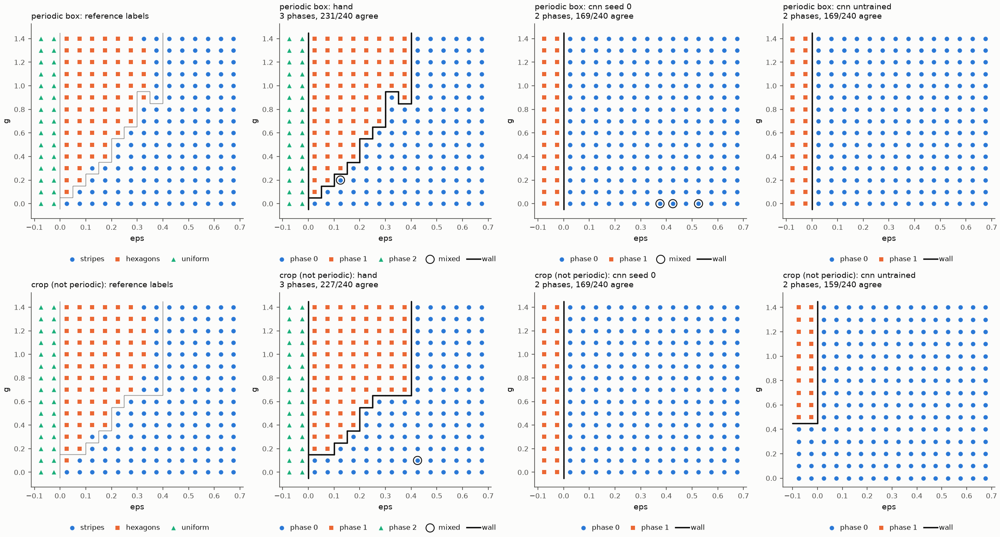
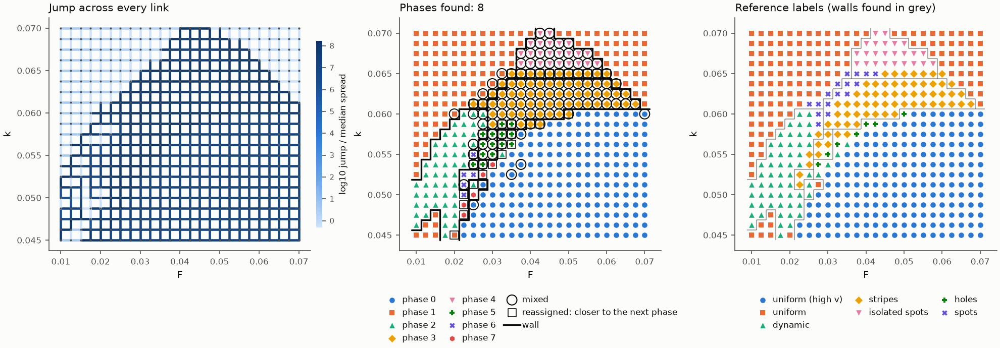

# PhaseWall

Work in progress.

PhaseWall finds the phases of a simulated system from runs already computed on a grid of
parameters. It places a wall between two neighbouring parameter points when their snapshots
differ more than the runs of one point differ from each other. No labels and no number of phases
are given.


More: [two-page summary](docs/TLDR.pdf) (schematics, examples that work and one that does not) ·
[documentation](docs/documentation.pdf) (method, mathematics, a physics parallel for each step, tests).

## Example: the Swift-Hohenberg equation

$$\partial_t u = \varepsilon u - (1 + \nabla^2)^2 u + g u^2 - u^3$$

The textbook model of pattern formation has three states in two dimensions: uniform
($\varepsilon < 0$), hexagons of spots (small $\varepsilon > 0$, $g > 0$) and stripes.
`phasewall demo` simulates $16 \times 15$ points $(\varepsilon, g)$ with 8 runs each from random
initial conditions (1920 runs, to $t = 5000$, about eight minutes on 8 cores), describes the last
6 snapshots of every run and searches for walls.

One snapshot from the middle of each phase found (common colour scale):



Left: jump across each link of the grid. Middle: the three regions and their walls; a ring marks
a point whose runs disagree. Right: the state of each point measured directly (skewness for spots
against stripes, amplitude), which PhaseWall never sees.


- 235 of 240 points carry the most common reference label of their region. The 5 others are on
  the hexagon-stripe boundary, where the 8 runs end in different states (5 or 6 hexagons, 2 or 3
  stripes), often with spots and stripes side by side in one box.
- These states are steady: continued to $t = 20\,000$, the patterns change by less than
  $10^{-5}$ over 500 time units (the patches are pinned to each other). At $t = 500$, the run
  time of an earlier version, one boundary point was still changing.
- 3 phases for `RATIO` (how much more the crossing links must jump than the inner ones) from 1.2
  to 2; 2 phases (uniform against patterned) from 2.5:


## How it works

1. **Describe** (`describe.py`, `fields.py`). Each snapshot becomes a vector of numbers that do
   not change when the box is rotated, mirrored or shifted: amplitude, shape of the structure
   factor $S(k)$, moments, number of connected domains above and below a few levels, global order
   $|\langle \mathbf a \rangle| / \langle |\mathbf a| \rangle$, divergence and curl of vector
   fields, and the change between two snapshots (frozen, travelling or changing). Vector and
   nematic components transform with the box (rotation by $90^\circ$:
   $(a_x, a_y) \to (-a_y, a_x)$, $\mathsf Q \to -\mathsf Q$).
2. **Compare neighbours** (`walls.py`, `graph.py`). The runs at one point form a sample; points
   one step apart in one parameter are linked. The jump $J(a, b)$ of a link is the energy distance
   between the two samples, zero only for equal distributions:

   $$D^2(X, Y) = 2\langle |x - y| \rangle - \langle |x - x'| \rangle - \langle |y - y'| \rangle .$$

   The spread $s(a) = D(a_1, a_2)$ of a point is the same distance between two halves of its sample.
3. **Cut.** Each link gets the weight $w = e^{-(J/\tilde J)^2}$ ($\tilde J$: median jump). A
   random walk on the grid rarely crosses large jumps, so it stays trapped in regions bounded by
   walls. Its slowest mode, the Fiedler vector of $L = 1 - d^{-1/2} W d^{-1/2}$ ($W$: weights, $d$:
   summed weights of each point), orders the points across the strongest barrier; the region is
   split where the normalised cut
   $\mathrm{cut}(S, \bar S)/\mathrm{vol}(S) + \mathrm{cut}(S, \bar S)/\mathrm{vol}(\bar S)$ is smallest.
4. **Test.** The cut is kept if its crossing links jump more than the inner links: one-sided
   Mann-Whitney $p <$ `ALPHA` $= 10^{-3}$ and ratio of medians $\ge$ `RATIO` $= 1.5$. It is placed
   with the first halves of the points ($J_1 = D(a_1, b_1)$) and tested with the second halves
   ($J_2 = D(a_2, b_2)$), so the test does not reuse the data that chose the cut. Both sides are
   cut again until no cut passes.

Then:

- **Runs that ended early** (crashed or unstable simulations): a run whose last snapshot comes
  before `END_FRACTION` = 0.1 of the median end time of all runs is left out, since its snapshots
  are early transients. A point whose runs all ended early is an *unstable* point, outside every
  phase (a cross on the phase map); `end_fraction=None` keeps every run.
- **Mixed points**: points with several runs whose runs differ far more than at the other points
  with several runs. Next to a first-order transition, runs at the same parameters can end in
  different states. Points with one run are not judged: the two time halves of one run are far
  more alike than two runs, so a common baseline flags almost every point with several runs.
- **One phase in two places** (on by default, `merge=False` to switch off): two phases that share
  no link are joined when the gap between their cores (points at least 2 grid steps from other
  phases) is below `RATIO` times the spread between the two halves of a core. A phase too small to
  split in two uses the spread of the other one.
- **Points near the walls** (on by default, `reassign=False` to switch off): the walls are cuts of
  the grid, so a single point in the state of the other side cannot be a phase of its own. Every
  point within 2 grid steps of another phase joins that phase when the core of that phase is
  `REASSIGN_RATIO` = 1.2 times closer to its snapshots than its own core. A cluster of moved points
  along a boundary means that both states are possible there.

### Threshold tree

An unsupervised alternative to the walls (`phasewall.trees`; trees fitted to labels are not
used). A phase boundary often shows as a jump of one descriptor, an order parameter, so the tree
gives its phases as rules, for example "skewness above 0.31".

- **Split.** In a region, the value of a point is the median of a descriptor over its snapshots.
  Each threshold is scored by the separation of the two sides (share of variance between them, as
  in Otsu's method: large for a gap, small for a drift) times their coherence on the grid
  (normalised cut of the grid links between them). The threshold is chosen anew in every region.
- **Test**, on the other half as for the walls: the two sides differ (Mann-Whitney, `ALPHA`); the
  median jump of that descriptor across crossing links is at least `RATIO` times the one across
  inner links (a jump, not a drift); the threshold puts 90% of the points on the same side. The
  tree stops when no split passes.
- **Both halves.** A split is kept only if the split placed with each half passes the test on the
  other and the two agree on 90% of the points. The better of the two rules on all snapshots is
  kept, so exchanging the halves gives the same tree.
- **One run per point.** The two time halves of one run are not independent (a frozen pattern
  gives the same values twice; the tree found 11 phases instead of 3 on Swift-Hohenberg). The
  points are then coloured as a checkerboard: a split placed on one colour is predicted for the
  other from its neighbours and tested there, then the colours are exchanged. This is chosen
  automatically when most points have one run.
- Separated leaves are joined as for the walls. On a learned description, which has no
  meaningful single directions, the tree runs on the principal components.

## Hand-made or learned description

Step 1 needs a function $f$ from a snapshot to a vector; steps 2 to 4 are the same for any $f$.

- **Hand-made** (`describe.py`): the descriptors above, 28 numbers per snapshot in the demo.
  Nothing is learned.
- **Learned** (`phasewall.nn`, extra `[nn]`, PyTorch): a convolutional encoder in a contrastive
  (SimCLR) set-up. A pair of frames $(t - \Delta t, t)$ goes through four convolution blocks that
  halve the grid, then the mean over the frame gives $h$ (256 numbers). It is trained on the
  ensemble without labels: two views of a run must be recognised among the views of the other runs
  (InfoNCE loss on $z = g(h)/|g(h)|$; the head $g$ is dropped after training).
  - A **view** is one pair of frames turned by any angle, mirrored, zoomed by a factor between 0.8
    and 1.25, cut to a square of 3/4 of the frame at a random place (vector and nematic components
    turn with the grid), and **normalised**. Scalar fields have their mean removed and are divided
    by their standard deviation. Vector and nematic fields are only divided by their root mean
    square, so their mean (a global polarisation or alignment, an order parameter) is kept
    (`keep_vector_mean`, default since 2026-11-20).
  - The views are what the description must not see, so the loss can only be lowered by the shape
    of the pattern. `views="d4"` (rotations by 90 degrees and shifts, whole frame, not
    normalised) gives the views used before 2026-11-19.

Comparison on the demo for the whole periodic box and for a centred $40 \times 40$ crop described
as a non-periodic frame (`scripts/compare_describers.py`, [docs/comparison](docs/comparison/summary.md)):

| frame | description | phases | points agreeing (of 240) | jump hexagons/stripes, relative | probe hexagons/stripes |
| --- | --- | --- | --- | --- | --- |
| periodic | hand-made | 3 | 235 | 1.9 | 1.00 |
| periodic | learned, 2 seeds | 3, 3 | 237, 235 | 2.0, 2.0 | 0.99, 1.00 |
| periodic | untrained network | 2 | 171 | 1.1 | 0.93 |
| periodic | learned with the old views (before 2026-11-19), 2 seeds | 2, 2 | 171, 171 | 1.4, 1.3 | 0.98, 0.98 |
| crop | hand-made | 3 | 235 | 2.0 | 0.99 |
| crop | learned, 2 seeds | 2, 2 | 171, 171 | 1.8, 1.7 | 0.99, 0.99 |
| crop | untrained network | 2 | 171 | 1.1 | 0.93 |
| crop | learned with the old views, 2 seeds | 2, 2 | 171, 171 | 1.2, 1.1 | 0.96, 0.94 |

Relative jump: median jump of the links between a hexagon point and a stripe point, divided by the
median of all jumps (about 1 inside a state). Probe: linear classifier of hexagons against stripes,
tested on held-out parameter points.



- **Periodic box.** The learned description finds the three phases for both training seeds. With
  the old views (rotations by 90 degrees, whole frame, amplitude kept), $h$ contained the
  difference between hexagons and stripes (probe 0.98), but it changed as much between neighbours
  inside a phase as across the boundary. Two causes were measured (plan step 18):
  - a fingerprint of each run: the wavevector of the periodic box, which rotations by 90 degrees
    leave unchanged; removed by turning and zooming each view on its own;
  - mostly the amplitude, which grows like $\sqrt{\varepsilon}$ inside a phase; removed by the
    normalisation.
- **Training is needed.** The untrained network with the same views gives 2 phases.
- **Non-periodic crop.** Still 2 phases, although the jump at the boundary went up from 1.1-1.2
  to 1.7-1.8. The turned and zoomed crop must stay inside the frame, so the network sees only 22 of
  the 40 points (less than three wavelengths), and the spread within a point is three times that
  of the periodic box.
- **Choosing views.** The usual diagnostics cannot choose views without labels: the old views
  have the lower loss and the higher rank of $h$, because easier views give a lower loss
  ([docs/networks](docs/networks/swift-hohenberg/summary.md)). The diagnostics only compare network
  shapes trained on the same views. With the new views every shape tried (3 or 5 blocks, narrow,
  wide $h$, $T = 0.5$) finds 3 or 4 phases (ARI 0.89 to 0.96). With the old views every shape
  found 2.

## Walls against blind grouping and a linear probe

Is cutting the parameter grid better than grouping the runs by their description alone? Three
blind methods (`phasewall.baselines`, extra `[baselines]`, scikit-learn) run on the same
descriptions. Each run is the mean of its snapshots, reduced to the principal components that
explain 95% of the variance. These runs are then grouped by:

- a Gaussian mixture ($k$ = 1 to 10, chosen by BIC);
- k-means ($k$ = 2 to 10, chosen by silhouette);
- HDBSCAN (minimum sizes 5 to 40; sparse runs are noise).

A logistic regression of the three states, tested on held-out points, sees the labels: it is a
ceiling on how well a description separates the states, not a way to find them.

| frame | description | method | groups | points agreeing (of 240) | ARI | pieces on the grid | runs left as noise |
| --- | --- | --- | --- | --- | --- | --- | --- |
| periodic | hand-made | walls | 3 | 235 | 0.93 | 3 | 0 |
| periodic | hand-made | Gaussian mixture ($k$ = 10) | 8 | 230 | 0.38 | 13 | 0 |
| periodic | hand-made | k-means ($k$ = 7) | 5 | 235 | 0.58 | 5 | 0 |
| periodic | hand-made | HDBSCAN (size 10) | 7 | 216 | 0.77 (0.66 with noise) | 11 | 12% |
| crop | hand-made | walls | 3 | 235 | 0.93 | 3 | 0 |
| crop | hand-made | HDBSCAN (size 20) | 3 | 237 | 0.97 (0.96 with noise) | 3 | 4% |
| periodic | learned | walls | 3 | 237 | 0.96 | 3 | 0 |
| periodic | learned | Gaussian mixture ($k$ = 10) | 10 | 235 | 0.30 | 16 | 0 |
| periodic | learned | HDBSCAN (size 20) | 4 | 117 | 0.90 (0.51 with noise) | 7 | 44% |

ARI: adjusted Rand index between the groups and the reference states of the points (1 for the
same partition, about 0 by chance). Pieces: connected pieces of the groups on the grid (3 for the
reference). All methods and settings: [docs/comparison/summary.md](docs/comparison/summary.md).


- **Periodic box.** Only the walls give the three states as three connected regions. The
  mixture picks the top of its range and cuts the phases into bands that follow the drift with
  $\varepsilon$ and $g$. k-means splits the patterned states into five groups. HDBSCAN leaves
  12-20% of the runs as noise and breaks the uniform state into small groups.
- **Crop.** HDBSCAN (sizes 10 and 20) also finds the three states, slightly closer to the
  reference than the walls (ARI 0.97 against 0.93), with 4% of the runs as noise. The mixture and
  k-means do not.
- **Learned description.** Only the walls give three pieces. HDBSCAN finds the states on the runs
  it places but leaves 27-49% as noise.
- **Why.** The probe recognises the three states in 99.5-99.9% of held-out snapshots
  (hand-made) and in 99-100% (learned, periodic box), so every description contains the states.
  Blind grouping needs the states to form separate clouds. Here the hexagon and stripe clouds
  touch and drift with the parameters. The walls only need a jump along the grid.

## Further examples

Four more models with known states (`phasewall demo --example NAME`). Each window and run time
was chosen with a pilot scan. Steady state was checked by continuing 24 runs to 2 and 4 times the
run time.

- **Gray-Scott** reaction-diffusion (fields $u$, $v$; parameters $F$, $k$; Pearson 1993): two
  uniform states, spots, isolated spots, holes, stripes and labyrinths, moving states. Grid steps
  0.0025 and 0.00125, $t = 40\,000$. On a grid twice as coarse, the 1-3 points wide pattern band
  was merged with a uniform state (5 phases, 113 of 143 points agree).
- **FitzHugh-Nagumo** (Hagberg-Meron form, symmetric bistable medium; $\varepsilon$, $\delta$):
  stationary fronts, moving domains, front turbulence, uniform states (up or down at random,
  equivalent by symmetry), Turing labyrinths, rings and spots. $a_0 = 0$: with $a_0 = -0.1$
  nothing moves.
- **Barkley** excitable medium ($a$, $b$ at $\varepsilon = 0.02$, $t = 4000$): rest, plane wave
  trains, spirals (counted by their tips, where the phase of $(u, v)$ winds by $2\pi$). It tests
  the dynamics block: a rotating spiral is seen as changing, because the moving correlation
  follows translations only.
- **Localised Swift-Hohenberg** (cubic-quintic,
  $\partial_t u = \varepsilon u - (1 + \nabla^2)^2 u + b u^3 - u^5$; $a = \varepsilon / b^2$, $b$):
  stripe patches that stay localised in the pinning range of homoclinic snaking, vanish below it or
  invade the box above. Patches start on the upper branch: one started at small amplitude decays
  whatever $\varepsilon$. With the quadratic-cubic equation of the demo, the pinning range of
  hexagon patches was narrower than 0.005 in $\varepsilon$.

Every example is described in three ways (learned: two training seeds, same phases) and compared
with every method, all with their defaults (`scripts/run_examples.py`, `scripts/tree_examples.py`;
[docs/examples/](docs/examples/overview.md)). Reference labels come from simple rules on the final
snapshots and are only used for scoring. ARI is on points.

| example | points x runs | walls, hand-made | tree, hand-made | walls, learned | walls, combined | closest blind method (hand-made) |
| --- | --- | --- | --- | --- | --- | --- |
| Swift-Hohenberg | 240 x 8 | 3 phases, ARI 0.93 | 3 phases, 0.94 | 3 phases, 0.96 | 3 phases, 0.94 | HDBSCAN 20: 0.78 (20% noise) |
| Gray-Scott | 525 x 4 | 8 phases, 0.89 | 10 phases, 0.94 | 1 phase | 4 phases, 0.86 | k-means, $k$ = 7: 0.99 |
| localised Swift-Hohenberg | 105 x 4 | 3 phases, 0.96 | 3 phases, 1.00 | 3 phases, 1.00 | 3 phases, 0.96 | HDBSCAN 10: 1.00 (13% noise) |
| FitzHugh-Nagumo | 99 x 4 | 1 phase | 1 phase | 2 phases, 0.19 | 1 phase | HDBSCAN 20: 0.71 (23% noise) |
| Barkley | 165 x 4 | 2 phases, 0.59 | 2 phases, 0.58 | 1 phase | 2 phases, 0.59 | HDBSCAN 20: 0.84 (14% noise) |

The table and the figures are from before the points near the walls were reassigned (2026-11-23).
With it, the hand-made walls give: Swift-Hohenberg ARI 0.94 (236 of 240 points), Gray-Scott 0.95
(498 of 525), localised Swift-Hohenberg 1.00 (105 of 105), Barkley 0.62 (136 of 165, 8 runs per
point); FitzHugh-Nagumo is unchanged.



- **One state per point.** Where every parameter point ends in one state, the walls and the tree
  agree with the reference on 92-98% of the points. The rules of the tree can be read:
  - localised Swift-Hohenberg: the variance of $u$ alone (zero, small for a patch, large for
    stripes everywhere);
  - Gray-Scott: flat or not, which uniform state, moving or not, then the shape of $S(k)$.

  With one run per point (checkerboard), the tree finds 3 phases on Swift-Hohenberg (ARI 0.90) and
  7 on Gray-Scott (0.96).
- **Joining separated pieces.** The three pieces of Gray-Scott's uniform state become one phase
  (10 to 8 phases, ARI 0.80 to 0.89). Nothing changes on the other examples.
- **Blind grouping** is sometimes closer (Gray-Scott: k-means). The walls are clearly ahead only
  on Swift-Hohenberg.
- **Learned description** (views of 2026-11-19). It finds the static patterns on its own: 3 phases
  on Swift-Hohenberg (ARI 0.96, 0.93) and on localised Swift-Hohenberg (1.00, 1.00); before, it
  found 2 and 1. It finds one phase on Gray-Scott, where part of the difference is the mean value
  that the normalisation removes, and on Barkley; it finds two weak ones on FitzHugh-Nagumo.
- **Combined table.** Every block has the same weight, so a few hand-made blocks count as much as
  the whole of $h$. On Gray-Scott it gives 4 phases (0.86), what the variance and mean of the fields
  give alone; with the learned description before the new views it gave 6 (0.95).
- **Barkley.** Rest is separated from activity, but plane waves are not separated from spirals.
  At 52 of 165 points the runs end in different states (whether a spiral pair survives depends on
  the initial condition).
- **FitzHugh-Nagumo** breaks two assumptions:
  - its equations are symmetric under $u \to -u$ but the descriptors are not, so uniform runs
    ending at $u \approx \pm 0.71$ at random look like two states;
  - at 48 of 99 points the runs end in different states, so the spread of a point is as large as
    the jumps.

## Usage

```
python3.12 -m venv .venv && source .venv/bin/activate
pip install -e ".[dev]"          # optional extras: nn (learned description), baselines (comparisons)
pytest

phasewall demo data/demo                 # the example above (about eight minutes)
phasewall demo data/quick --quick        # a small version in a few seconds
```

**Your own runs.** `phasewall inspect run0/Data/0000001000.jld2` lists the datasets of one
snapshot file (name, shape, type) and suggests `[[fields]]` blocks. Components saved as separate
datasets (`vx`, `vy`; `Qxx`, `Qxy`) are grouped into one field, and names suggest a role (`v`:
velocity, `p`: polarity, `Q`: nematic). Nothing is applied until you check it. Then describe the
ensemble in a TOML file (`src/phasewall/io.py`):

```toml
[ensemble]
runs = "runs.csv"              # one row per run: a column `path`, one column per parameter
parameters = ["rho0", "zeta"]
snapshots = "Data/*.jld2"      # snapshot files inside each run folder
time_regex = '(\d+)\.jld2$'    # the time is the number in the file name
julia_order = true             # arrays written by Julia (column-major)
dx = 0.01
last = 10                      # the last 10 snapshots of every run are described
pair_dt = 1000.0               # time between the two snapshots used for the dynamics
periodic = true                # periodic boundary conditions
# optional: the frame described in every run (needed when boxes or grids differ between runs)
crop = 5.0                     # side of a centred square crop
dx_target = 0.02               # coarsen to this grid spacing (an integer multiple of dx)
max_shift = 1.0                # moving correlation: shifts up to this in x and y

[[fields]]
name = "rho"
keys = ["C", "rho"]            # names it may have in the files
kind = "scalar"                # scalar, velocity, polarity, vector (role not given) or nematic
relative = true                # describe (rho - <rho>) / <rho>

[[fields]]
name = "p"
keys = ["P"]                   # one dataset with both components
kind = "polarity"
blocks = ["amp", "shape", "defects"]   # optional: the observables to compute (default: by kind)

[[fields]]
name = "v"
components = ["vx", "vy"]      # or two scalar datasets, stacked as (x, y)
kind = "velocity"
```

- Unknown keys are errors. A scalar field named like a component (`vx`, `p_y`, `Qxx`) is refused,
  because a component alone is not invariant under rotations; add `single_component = true` if it
  really is a scalar of its own.
- Each kind has default blocks of observables (velocity: vortex cores by the Okubo-Weiss
  criterion; polarity: winding-number defects $\pm1$; nematic: defects $\pm\frac12$; both: the
  Frank energy of the orientation, below); `blocks` replaces them. The block `parts` is opt-in. It compares square blocks of half the frame side and
  is large when two states sit side by side in one frame (hexagons next to stripes, spots on a
  uniform background).
- The block `frank` (polarity and nematic) is the Frank energy with one constant, weighted by the
  order squared so that defect cores stay finite: splay $m^2(\nabla\cdot\mathbf n)^2$ and bend
  $m^2|\mathbf n\times\nabla\times\mathbf n|^2$ ($m = |\mathbf p|$ or $S$). Columns: $\log_{10} F$, the
  splay share, and $\ln F(t) - \ln F(t - \Delta t)$ over the pair of snapshots (negative while the
  orientation relaxes or coarsens, near 0 when steady, of either sign when it oscillates).
- A vector or nematic field whose fluctuations are below $10^{-3}$ of its size is taken as exactly
  uniform, so the numerical noise of a uniform state is not described as a pattern.
- The grid spacing can be given per run, as a column `dx` of the table of runs.
- A whole periodic box is described with FFTs and periodic shifts. A crop or a non-periodic box
  ($L$ its side, $s$ = `max_shift`, by default $L/5$) is described without periodicity:
  - $S(k)$ times a Tukey window, for wavelengths up to a third of the frame;
  - divergence and curl by finite differences;
  - domains not joined across the edges;
  - the moving correlation by sliding the frame at $t$ over the frame at $t - \Delta t$ by up to
    $\pm s$ in $x$ and $y$ (a crop of a non-periodic box stays $s$ away from the walls, so by
    default its side is $L - 2s$).

  Such frames are invariant under rotations and mirrors only.

Then:

```
phasewall describe ensemble.toml --workers 4      # -> descriptors.csv, one row per snapshot
phasewall walls descriptors.csv --config ensemble.toml

phasewall learn ensemble.toml                     # learned description -> encoder/descriptors_cnn.csv
phasewall learn ensemble.toml --blocks 3 --dim-h 128 --projection 32   # another shape, checked first
phasewall learn ensemble.toml --views d4 --no-normalise                # the views used before 2026-11-19
phasewall walls encoder/descriptors_cnn.csv --config ensemble.toml
phasewall describe other.toml --encoder encoder   # the trained encoder on another ensemble
```

The checks on the learned encoder:

- **Before training.** Its shape (blocks, width, $\dim h$, head, temperature) and views (`--views`,
  `--zoom`, `--crop`, `--no-normalise`, `--centre-vectors`) are checked against the frame. The last
  map must have at least 2 points per side, channels never decrease, and the projection is no
  larger than $\dim h$ or the hidden layer. The summary gives the receptive field (7, 19, 43, 91
  points for 1 to 4 blocks), the number of weights and a rough memory estimate.
- **Input size.** The network sees the crop of its views: at least what its blocks need in a
  periodic frame, and small enough to stay inside a non-periodic one.
- **Comparing shapes.** Shapes are compared without labels, by the loss, alignment, uniformity
  and effective rank of $h$, never by scores, which would bring the labels back in
  (`scripts/compare_networks.py`, [docs/networks/](docs/networks/swift-hohenberg/summary.md)).

`walls` writes a folder with:

- `summary.md`;
- `nodes.csv`: one row per parameter point, with its region and phase;
- `edges.csv`: one row per link, with its jump and whether it is a wall;
- `cuts.csv` and `robustness.csv`;
- the figures shown above.

It reads any table with one row per snapshot and descriptor columns named `field.block.name`
(`--parameters` instead of `--config`).

### Interactive interface

The same analyses run from a [marimo](https://marimo.io) page ([apps/explore.py](apps/explore.py)),
which opens as a dashboard or as a notebook:

```
./explore.sh                         # dashboard in the browser, from any folder
./explore.sh --edit                  # the same page as a notebook, code visible
```

The first time, the script makes `.venv` (Python 3.11 or newer) and installs PhaseWall with the
extra `[app]` (marimo, PyTorch, scikit-learn); nothing has to be activated. By hand:
`pip install -e ".[app]"`, then `marimo run apps/explore.py`. The page has one section per step:

1. **System**: an example (grid and numerical settings), your own runs (a CSV table with a column
   `path` and one per parameter, HDF5 or JLD2 snapshots; optional columns `dx` and a label column,
   used only for scores), an ensemble TOML file, or a CSV table of descriptors made elsewhere.
2. **Fields** (your runs): the datasets of the first snapshot are listed and fields suggested from
   the names (`vx` and `vy` grouped into one velocity). You confirm the kind of each field (scalar,
   velocity, polarity, vector or nematic), and the app writes the TOML file.
3. **Encoders**:
   - hand-made, with the observable blocks of each field as a grid of checkboxes (a box only where
     the block fits the kind, with the definition of each block);
   - learned, with the network shape checked before training;
   - combined;
   - encoders registered by other packages.
4. **Methods**: walls (with the joining of separated phases), the threshold tree, Gaussian
   mixture, k-means, HDBSCAN, registered methods. **Checks**: robustness, probe (labels only for
   scoring), learning curve.

The controls of the tree, the network and registered entries are built from their settings
(`registry.settings_spec`), so a new entry needs no interface code. An estimate of the cost is
shown before the run, and every step is cached. The result tabs are:

- the phase map (walls or tree);
- the comparison of descriptions and methods;
- snapshots of each phase;
- the rules of the tree, with the meaning of each descriptor (`describe.explain`);
- the details of the walls;
- the training curves;
- export of the tables and figures.

Style: [apps/explore.css](apps/explore.css). Details: [apps/README.md](apps/README.md).

### Structure and extensions

There are three layers:

- the core `phasewall` does all the work and does not depend on any interface;
- `phasewall.pipeline` takes settings and returns results, and is called by the scripts, the
  command-line tool and the interface;
- `apps/` only fills in settings and shows results.

Labels never enter a method. They are only used for scores and the probe.

Every encoder and method, the built-in ones included, is registered with a settings dataclass and
one function (`registry.py`; built-ins in `builtins.py`). A new one is one file, and then it runs
in the pipeline, the scripts and the scores:

```python
from dataclasses import dataclass, field
from phasewall import pipeline as pl, registry

@dataclass
class HalfSettings:
    column: str = field(default="eps", metadata={"help": "parameter cut", "choices": ("eps", "g")})

@registry.method("half", HalfSettings, help="lower and upper half of a parameter", uses_grid=True)
def half(table, parameters, settings, context):
    p = table.groupby("run")[settings.column].first()
    return registry.MethodResult((p >= p.median()).astype(int))   # one group per run

res = pl.run(pl.Settings(methods=pl.Methods(others={"half": HalfSettings()})))
```

- An encoder is `run(ensemble, settings, context)`, returning tables with one row per snapshot.
- The metadata of the settings (`help`, `choices`, `range`) describe the controls of an interface
  and are checked before a run.
- `tests/test_contracts.py` checks every registered entry: output format, one phase in noise and
  two on a step, and invariance of the descriptions under rotations, mirrors and shifts. A new
  entry is tested by registering it.
- Other packages register their entries through the entry points `phasewall.encoders` and
  `phasewall.methods`.

## Tests

`pytest` runs 220 tests on small synthetic fields with known answers, in about a minute:

- **Fields and files**: symmetry rules of vector and nematic fields, checked against the gradient
  of a scalar and the tensor of a director field; velocity and polarity turning as vectors; file
  round trips in Julia layout; fields assembled from component datasets; components refused as
  scalars; the suggestions of `phasewall inspect`.
- **Descriptors**:
  - $S(k)$ of a single wave; domain counts of spots against stripes;
  - curl-free and divergence-free flows; vortex cores of Gaussian vortices and of a cellular flow;
    $\pm1$ and $\pm\frac12$ winding defects; Frank energy of a turning orientation ($F = k^2$),
    of an aster (splay) and a vortex (bend), and its change over the lag; numerical noise on a
    uniform vector or nematic ignored;
  - frozen, travelling and changing patterns; two states side by side (`parts`); blocks chosen
    per field;
  - invariance of every descriptor under the eight symmetries of the square and periodic shifts.
- **Frames**: $S(k)$ of crops against the exact one; finite against spectral derivatives; the
  windowed moving correlation; rotation and mirror invariance; the same descriptors at $\Delta x$
  and $\Delta x/2$ after coarsening; mixed grids refused without a common frame.
- **Walls**: the links of a refined grid; no wall in pure noise or under a smooth drift; walls on
  the right links for two and three phases; runs that ended early left out (unstable points); a
  bistable point flagged as mixed; points in a band where the states alternate from point to point
  given to the phase of their state; mixed judged only
  among points with several runs; a drifting run not flagged as mixed.
- **Swift-Hohenberg runs**: the state, and the stripe amplitude
  $\mathrm{std}(u) = \sqrt{2\varepsilon/3}$ of weakly nonlinear theory.
- **Learned description**:
  - augmentations against the field rules; shift invariance of the periodic encoder; the loss at
    collapse; a short training that separates stripes from spots; saving and loading;
  - views: normalisation (vectors keep their mean); a turn by 90 degrees exact; the wavelength
    kept at any angle; vectors and nematics turned with the grid, checked against gradients of a
    turned scalar; views saved with the encoder; old encoders read with the old views.
- **Blind grouping and probe**: separated clouds found; groups in two places; real against random
  labels.
- **Registry**: every registered encoder and method (contracts above).
- **Command line and interface**: every command. With the extra `[app]`, `tests/test_app.py`
  checks the parsing of typed values and runs the quick demo with every tab drawn.

## Development history and next steps

| Step | Content | Status |
| --- | --- | --- |
| 1 | Package: fields and their symmetries, descriptors, parameter graph, walls method, Swift-Hohenberg demo | done |
| 2 | Tests on synthetic data with known answers, continuous integration (ruff, pytest) | done |
| 2b | Frames: crops, coarsening, per-run grid spacing, non-periodic boxes; errors for unknown settings | done |
| 3 | Command-line tool `phasewall inspect \| toy \| describe \| learn \| walls \| demo`, report (summary, tables, figures) | done |
| 4 | Documentation: method, mathematics, physics parallels, tests ([PDF](docs/documentation.pdf)) | done |
| 5 | Check on real simulations of an active fluid ([PRX Life 4, 043009](https://doi.org/10.1103/bnx5-sryc)), from their descriptors and from a learned description, against published phase diagrams. The data stay outside this repository | next |
| 6 | Learned description (extra `[nn]`): contrastive encoder on snapshot pairs, augmentations from the field symmetries; on the demo 2 phases of 3, then 3 of 3 with the views of step 18 | done |
| 6b | Comparison with blind grouping (Gaussian mixture, k-means, HDBSCAN) and a logistic probe, on both descriptions | done |
| 6c | [Threshold tree](#threshold-tree), a method of the pipeline (`Methods(tree=True)`). Swift-Hohenberg 3 phases ARI 0.94, Gray-Scott 10 phases 0.94, localised Swift-Hohenberg 1.00 | done (2026-11-18) |
| 6d | Joining one phase found in two places (cores compared, [How it works](#how-it-works)). Gray-Scott 10 to 8 phases, ARI 0.80 to 0.89; no change elsewhere | done (2026-11-18; on by default) |
| 7 | README figures of the method and of the encoder | overview figure done (2026-11-22) |
| 8 | Four more examples with known answers ([Further examples](#further-examples)); batch run with hand-made, learned and combined descriptions (`scripts/run_examples.py`, `docs/examples/`) | done (Barkley rerun to $t = 4000$) |
| 8a | Examples registry (`phasewall demo --example`); `phasewall.pipeline` (one call, cached steps); plot functions returning figures; progress callbacks; CSV tables as input; combined description; learning curve | done |
| 8b | Interactive interface ([apps/explore.py](apps/explore.py), marimo): sources, descriptions and methods chosen on the page; phase maps, comparison, snapshots, walls, training curves and export in tabs ([docs/plan_interface.md](docs/plan_interface.md)) | done |
| 9 | Licence and public release, once step 5 shows that the method works on real data | planned |
| 10 | Field roles (scalar, velocity, polarity, nematic); vectors and tensors from one dataset or from component datasets; `phasewall inspect` suggests roles that the user confirms | done (2026-11-18) |
| 11 | Observable blocks switched on or off per field (`blocks`, `Describers(blocks=...)`); vortex cores (Okubo-Weiss), winding defects $\pm1$ and $\pm\frac12$; Frank energy (splay, bend, change over the lag) for polarities and nematics (2026-11-23) | done (2026-11-18) |
| 12 | Registries of encoders and methods, self-describing checked settings, entry points, contract tests; the pipeline runs everything through them (same results) | done (2026-11-18) |
| 13 | Tunable CNN (`nn/architecture.py`, no PyTorch needed to check): shape checked against the frame, receptive field, weights, memory estimate; `phasewall learn --blocks --width --dim-h ...`; shapes compared by label-free diagnostics | done (2026-11-18) |
| 14 | Interface for steps 10 to 13: field inspector (TOML written by `io.write_config`), blocks per field, network checked before training, tree and registered entries; checked in a browser | done (2026-11-18) |
| 15 | Interface layout: no sidebar; the settings as sections on the main page in the order of an analysis (frame and execution folded), a run bar, results below; a stylesheet | done (2026-11-18) |
| 16 | Blocks as a grid of checkboxes (fields × blocks), HDBSCAN sizes as checkboxes; a one-line definition of every block and of every descriptor column (e.g. `u.topo.below-1`: domains per unit area where $u$ is below its mean minus one standard deviation), shown with the rules of the tree and in the results | done (2026-11-18) |
| 17 | Coexistence in one frame (Binder's block distribution): block `parts`, the spread over square blocks of half the frame side of six local numbers (variance, mean, skewness, kurtosis, local wavenumber, anisotropy). Marks hexagons next to stripes (21 Swift-Hohenberg boundary points with 1 or 2 such runs of 8, unseen by the mixed flag) and spots on a uniform background (Gray-Scott). It does not improve the walls (Swift-Hohenberg unchanged, Gray-Scott 482 to 478 of 525 points), so it is opt-in. Binder's slope against block size: noisy, merged phases, dropped | done (2026-11-18; opt-in) |
| 18 | Views of the learned encoder. With the old views $h$ carried a run fingerprint, the wavevector mode of the periodic box: hexagons and stripes of the same mode were about as far apart as two stripe patterns of different modes (ratio 1.3; hand-made 6). These still gave 2 phases: rotation by any angle with crops (ratio 3.9), VICReg instead of InfoNCE (0.84, 3.96), independent zoom per view (4.5), smaller crops, multi-crop, runs of the same point removed from the negatives. The main cause was the amplitude, which changes smoothly inside a phase. Each view normalised, with rotation and zoom: 3 phases for 3 seeds (234 to 237 of 240, ARI 0.91 to 0.96; hand-made 235, 0.93); normalisation with 90-degree views only: 2. Three seeds per example: Swift-Hohenberg 0.91 to 0.94, localised 1.00, 0.79, 1.00 (hand-made 0.96); no reliable gain on Gray-Scott (0.45 to 0.75), Barkley (one seed of three), FitzHugh-Nagumo. In the package (`nn/views.py`, on the GPU, saved with the encoder); batch with two seeds: Swift-Hohenberg 0.96, 0.93; localised 1.00, 1.00; Gray-Scott and Barkley 1 phase; FitzHugh-Nagumo 2 weak (0.19, 0.17); combined Gray-Scott 0.95 to 0.86. Open: non-periodic frames | done (2026-11-19) |
| 19 | Masked autoencoder: hide most patches of a field and reconstruct them. With no pair of views, nothing rewards telling runs apart, so the encoder learns local physics (wavelength, cells, defects). Needs patches as tokens (or a sparse CNN) and a decoder; only if better views are not enough | planned |
| 20 | Order parameters of a wall: for each pair of neighbouring phases (any description, in particular the learned one), the hand-made observables that jump across it. For each: its jump relative to the jumps inside each phase, one threshold that reproduces the wall (physical units), step or onset, and for a learned wall the share of the separating direction of $h$ they explain. Chosen on half of the runs, scored on the other (many observables, chance hits). Checks that a learned wall is physical | to think about |
| 21 | Learned weights for the hand-made encoder. (a) One weight per descriptor trained contrastively on views. Risk: rewarding run fingerprints. Swift-Hohenberg 234 against 235 of 240; std, mean and variance ranked highest, $S(k)$ last; a small network instead: 2 phases. (b) Weights that make the jumps along the grid sparse (inverse participation ratio), placed on half of the runs, tested on the other. No false wall in 80 noise and drift tables; finds a diluted jumping column that equal weights miss; Swift-Hohenberg ARI 0.94 (0.93); Gray-Scott 0.62 (0.80), the weights collapse on one column. Per block, with noise between runs: Swift-Hohenberg 2 phases, Gray-Scott 0.79. The objective picks the most localised observable (Swift-Hohenberg: the dynamics), not one the test confirms, and a rejected cut is not retried. Later: an objective that includes the power of the test, or a fallback to equal weights | tested, left for later |
| 22 | Symmetries of the description: $h$ should have exactly the symmetries of the system. Today: rotations, mirrors, shifts; not symmetries of field values ($u \to -u$ in FitzHugh-Nagumo), Galilean invariance, a phase gauge or a swap of species. To decide: how a user declares them (per field, per system), how observables and views respect them, and a warning when the data suggest an undeclared one | to think about |
| 23 | Several states near the walls (prototype): runs at points touching a wall join the closest phase core (runs at least two links from another phase), relative to each core's spread. Swift-Hohenberg: all 408 clear runs at those points assigned right (93% if each run takes its point's phase), the 10 bistable points found; runs with hexagons and stripes side by side are far from every core and have a high `parts`. Fails when bistability is spread out (Barkley: the cores are mixtures) | tested, prototype |
| 24 | Branches, the walls on a graph of runs (prototype): runs linked to the runs of the same and neighbouring points; first halves of the snapshots place the cuts, second halves test them. A point with runs in two branches is bistable; each branch has its existence region. No false branch on 120 synthetic one-state tables. Barkley, 8 runs per point: rest and spirals one branch each, ARI on runs 0.74 (walls on points 0.59), 65 of 66 bistable points found (15 false). Swift-Hohenberg ARI 0.90, but a stripe branch splits off (25 false bistable points). Open: joining branches that are one state (a merge tried joins different states once a branch is a mixture), an effect-size threshold for runs | tested, prototype |

Open questions:

- **Noise with one run per point.** The spread is then measured between the two time halves of the
  run, which are much more alike than two runs at the same parameters (4 to 7 times, in scans with
  both). The spread and the `mixed` flag come out too small, and the threshold tree, which tests
  with those halves, over-splits. Planned: noise from runs at neighbouring points. The walls' test
  compares jumps between different points and is not affected.
- **Learned description.** It finds static patterns that differ by shape. Open: states that differ
  by the mean value of a scalar field (Gray-Scott's uniform states; removed by the normalisation on
  purpose), dynamic systems (Barkley, FitzHugh-Nagumo), a masked autoencoder (step 19). A combined
  table is dominated by its smallest blocks, since every block has the same weight.
- **Power of the split-sample test.** The demo needs 6 to 8 runs per point to find the weak
  hexagon-stripe wall. Cross-fitting (place with one half, test with the other, then swap) could
  use all runs.
- **Mixed points.** Since 2026-11-23 only points with several runs are judged, against each
  other. A split of 7 runs against 1 at a boundary point is not flagged; a test per
  point (for example bimodality of its runs) could replace the robust threshold.
- **Several states per point** (FitzHugh-Nagumo, Barkley): describe each point as a mixture of
  states (steps 23, 24).
- **Odd fields.** A field rule making the descriptors even when the equations are symmetric under
  $u \to -u$ (the mean and the skewness change sign).
- **Scans that are not grids**: links between nearest neighbours.
- **Bistable regions** that runs from one kind of initial condition never reach (Section 8 of the
  documentation): runs from several initial conditions per point.

## References

Every entry was checked against the publisher's or the author's page (2026-11-23). The full list with
DOIs is at the end of [docs/documentation.pdf](docs/documentation.pdf).

**The system the method was built for**
- L. Dumoulin, C. Blanch-Mercader and K. Kruse, Defect states in compressible active polar fluids with renewal, *PRX Life* **4**, 043009 (2026). [doi:10.1103/bnx5-sryc](https://doi.org/10.1103/bnx5-sryc)

**The method**
- G. J. Székely and M. L. Rizzo, Energy statistics: a class of statistics based on distances, *J. Stat. Plann. Inference* **143**, 1249 (2013). [doi:10.1016/j.jspi.2013.03.018](https://doi.org/10.1016/j.jspi.2013.03.018)
- J. Shi and J. Malik, Normalized cuts and image segmentation, *IEEE Trans. PAMI* **22**, 888 (2000). [doi:10.1109/34.868688](https://doi.org/10.1109/34.868688)
- M. Fiedler, Algebraic connectivity of graphs, *Czech. Math. J.* **23**, 298 (1973). [doi:10.21136/CMJ.1973.101168](https://doi.org/10.21136/CMJ.1973.101168)
- U. von Luxburg, A tutorial on spectral clustering, *Stat. Comput.* **17**, 395 (2007). [doi:10.1007/s11222-007-9033-z](https://doi.org/10.1007/s11222-007-9033-z)
- H. B. Mann and D. R. Whitney, On a test of whether one of two random variables is stochastically larger than the other, *Ann. Math. Stat.* **18**, 50 (1947). [doi:10.1214/aoms/1177730491](https://doi.org/10.1214/aoms/1177730491)
- N. Otsu, A threshold selection method from gray-level histograms, *IEEE Trans. Syst. Man Cybern.* **9**, 62 (1979). [doi:10.1109/TSMC.1979.4310076](https://doi.org/10.1109/TSMC.1979.4310076)

**Learned description**
- T. Chen, S. Kornblith, M. Norouzi and G. Hinton, A simple framework for contrastive learning of visual representations (SimCLR), *Proc. ICML*, PMLR **119**, 1597 (2020). [proceedings](https://proceedings.mlr.press/v119/chen20j.html)
- A. van den Oord, Y. Li and O. Vinyals, Representation learning with contrastive predictive coding (InfoNCE), [arXiv:1807.03748](https://arxiv.org/abs/1807.03748) (2018).
- I. Loshchilov and F. Hutter, Decoupled weight decay regularization (AdamW), ICLR 2019, [arXiv:1711.05101](https://arxiv.org/abs/1711.05101).
- A. Bardes, J. Ponce and Y. LeCun, VICReg, ICLR 2022, [arXiv:2105.04906](https://arxiv.org/abs/2105.04906).
- K. He, X. Chen, S. Xie, Y. Li, P. Dollár and R. Girshick, Masked autoencoders are scalable vision learners, *Proc. CVPR*, 16000 (2022), [arXiv:2111.06377](https://arxiv.org/abs/2111.06377).

**Comparisons and scores**
- A. P. Dempster, N. M. Laird and D. B. Rubin, Maximum likelihood from incomplete data via the EM algorithm, *J. R. Stat. Soc. B* **39**, 1 (1977). [doi:10.1111/j.2517-6161.1977.tb01600.x](https://doi.org/10.1111/j.2517-6161.1977.tb01600.x)
- G. Schwarz, Estimating the dimension of a model (BIC), *Ann. Stat.* **6**, 461 (1978). [doi:10.1214/aos/1176344136](https://doi.org/10.1214/aos/1176344136)
- S. P. Lloyd, Least squares quantization in PCM (k-means), *IEEE Trans. Inf. Theory* **28**, 129 (1982). [doi:10.1109/TIT.1982.1056489](https://doi.org/10.1109/TIT.1982.1056489)
- P. J. Rousseeuw, Silhouettes, *J. Comput. Appl. Math.* **20**, 53 (1987). [doi:10.1016/0377-0427(87)90125-7](https://doi.org/10.1016/0377-0427(87)90125-7)
- R. J. G. B. Campello, D. Moulavi and J. Sander, Density-based clustering based on hierarchical density estimates (HDBSCAN), PAKDD 2013, LNCS **7819**, 160. [doi:10.1007/978-3-642-37456-2_14](https://doi.org/10.1007/978-3-642-37456-2_14)
- L. Hubert and P. Arabie, Comparing partitions (adjusted Rand index), *J. Classif.* **2**, 193 (1985). [doi:10.1007/BF01908075](https://doi.org/10.1007/BF01908075)

**Observables**
- A. Okubo, Horizontal dispersion of floatable particles in the vicinity of velocity singularities such as convergences, *Deep-Sea Res.* **17**, 445 (1970). [doi:10.1016/0011-7471(70)90059-8](https://doi.org/10.1016/0011-7471(70)90059-8)
- J. Weiss, The dynamics of enstrophy transfer in two-dimensional hydrodynamics, *Physica D* **48**, 273 (1991). [doi:10.1016/0167-2789(91)90088-Q](https://doi.org/10.1016/0167-2789(91)90088-Q)
- F. C. Frank, On the theory of liquid crystals, *Discuss. Faraday Soc.* **25**, 19 (1958). [doi:10.1039/DF9582500019](https://doi.org/10.1039/DF9582500019)
- K. Binder, Finite size scaling analysis of Ising model block distribution functions, *Z. Phys. B* **43**, 119 (1981). [doi:10.1007/BF01293604](https://doi.org/10.1007/BF01293604)
- J. P. Lewis, Fast template matching, Vision Interface 1995, 120 (expanded as *Fast normalized cross-correlation*).

**Examples**
- J. Swift and P. C. Hohenberg, Hydrodynamic fluctuations at the convective instability, *Phys. Rev. A* **15**, 319 (1977). [doi:10.1103/PhysRevA.15.319](https://doi.org/10.1103/PhysRevA.15.319)
- M. C. Cross and P. C. Hohenberg, Pattern formation outside of equilibrium, *Rev. Mod. Phys.* **65**, 851 (1993). [doi:10.1103/RevModPhys.65.851](https://doi.org/10.1103/RevModPhys.65.851)
- R. Hoyle, *Pattern Formation: An Introduction to Methods* (Cambridge University Press, 2006).
- J. E. Pearson, Complex patterns in a simple system, *Science* **261**, 189 (1993). [doi:10.1126/science.261.5118.189](https://doi.org/10.1126/science.261.5118.189)
- A. Hagberg and E. Meron, From labyrinthine patterns to spiral turbulence, *Phys. Rev. Lett.* **72**, 2494 (1994). [doi:10.1103/PhysRevLett.72.2494](https://doi.org/10.1103/PhysRevLett.72.2494)
- D. Barkley, A model for fast computer simulation of waves in excitable media, *Physica D* **49**, 61 (1991).
- J. Burke and E. Knobloch, Localized states in the generalized Swift-Hohenberg equation, *Phys. Rev. E* **73**, 056211 (2006). [doi:10.1103/PhysRevE.73.056211](https://doi.org/10.1103/PhysRevE.73.056211)

## Acknowledgements

The code, tests and documentation were written by Claude (Anthropic), an AI assistant. The author
designed the method, chose the physics, the examples and the checks, directed the work step by step
and reviewed the results.
