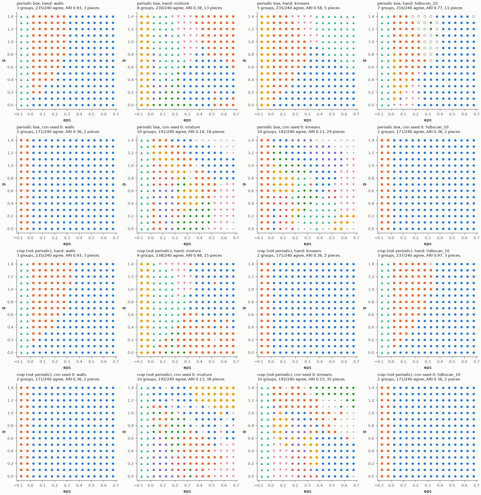

# phasewall

Work in progress.

phasewall finds the phases of a simulated system from an ensemble of runs that were already
computed on a grid of parameters. Each snapshot is described by generic numbers computed from
its fields (density, velocity, polarity, nematic order, ...). Neighbouring parameter points are
compared, and a wall is placed wherever the description changes more than it varies within one
point. The regions enclosed by the walls are the candidate phases of the scanned range. No
labels and no number of phases are given in advance.

The method, its mathematics, a physics parallel for each step and the tests are described in
[docs/documentation.pdf](docs/documentation.pdf).

## Example: the Swift-Hohenberg equation

The demo uses a model with a known answer, the Swift-Hohenberg equation, the textbook model of
pattern formation:

$$\partial_t u = \varepsilon u - (1 + \nabla^2)^2 u + g u^2 - u^3 .$$

In two dimensions it has three states: uniform ($\varepsilon < 0$), hexagons of spots (small
$\varepsilon > 0$ with $g > 0$) and stripes. `phasewall demo` simulates $16 \times 15$ parameter
points $(\varepsilon, g)$ with 8 runs each from different random initial conditions (1920 runs,
about eight minutes on 8 cores), runs them to $t = 5000$ (steady: see below), describes the last 6
snapshots of every run and searches for walls.

One snapshot from the middle of each phase found, on a common colour scale:


The phase map. Left: how much the description changes across each link of the parameter grid.
Middle: the three regions found and the walls between them; the ring marks a point whose runs
disagree with each other. Right: the state of each point measured directly (spot or stripe
symmetry from the skewness, amplitude), which phasewall never sees.


235 of the 240 points carry the most common reference label of their region. The 5 others lie
on the hexagon-stripe boundary, where the 8 runs of one point end in different states (5 or 6
hexagons against 2 or 3 stripes), often with patches of spots and stripes side by side in one
box. These are steady states, not transients: runs at such points continued to $t = 20\,000$ do
not change (their patterns change by less than $10^{-5}$ over 500 time units), the patches of the
two states being pinned to each other. An earlier version ran to $t = 500$ only, where one
boundary point was still changing; hence $t = 5000$. The number of phases stays at 3 when the threshold `RATIO` (how much more the
crossing links must jump than the inner ones) goes from 1.2 to 2, and drops to 2 (uniform
against patterned) from 2.5:


## How it works

1. **Describe.** Every snapshot becomes a vector of numbers that do not change when the box is
   rotated, mirrored or shifted: amplitude, the shape of the structure factor $S(k)$, moments of
   the values, the number of connected domains above and below a few levels, global order
   $|\langle \mathbf a \rangle| / \langle |\mathbf a| \rangle$, divergence and curl of vector
   fields, and how the pattern changes between two snapshots (frozen, travelling or changing).
   Vector and nematic fields are transformed with their components (a rotation by $90^\circ$
   sends $(a_x, a_y) \to (-a_y, a_x)$ and $\mathsf Q \to -\mathsf Q$), so the invariance holds
   for all field types (`describe.py`, `fields.py`).
2. **Compare neighbours.** The runs at one parameter point form a sample. Two points that
   differ by one step in one parameter are linked. For each link the jump $J(a, b)$ is the
   energy distance between the two samples,

   $$D^2(X, Y) = 2\langle |x - y| \rangle - \langle |x - x'| \rangle - \langle |y - y'| \rangle ,$$

   which vanishes only when the two distributions are equal; for each point the spread
   $s(a) = D(a_1, a_2)$ is the same distance between two halves of its own sample
   (`walls.py`, `graph.py`).
3. **Cut.** Each link gets a weight $w = e^{-(J/\tilde J)^2}$, with $\tilde J$ the median
   jump. A random walk on the grid, which moves easily along small jumps and rarely across
   large ones, stays trapped in regions bounded by walls. The slowest mode of this diffusion
   (the Fiedler vector, second eigenvector of $L = 1 - d^{-1/2} W d^{-1/2}$, with $W$ the weights
   and $d$ the diagonal matrix of the summed weights of each point) orders the points
   across the strongest barrier, and the region is split where the normalised cut
   $\mathrm{cut}(S, \bar S)/\mathrm{vol}(S) + \mathrm{cut}(S, \bar S)/\mathrm{vol}(\bar S)$ is
   smallest.
4. **Test.** A cut is kept only if its crossing links jump more than the inner links: a
   one-sided Mann-Whitney test with $p <$ `ALPHA` $= 10^{-3}$ and a ratio of medians of at least
   `RATIO` $= 1.5$. The cut is placed with the jumps between the first halves of the points,
   $J_1 = D(a_1, b_1)$, and tested with the jumps between the second halves,
   $J_2 = D(a_2, b_2)$, so the test does not reuse the data that chose the cut. Both sides are
   then cut again until no cut passes.

Points whose two halves differ far more than usual are flagged as mixed: next to a
first-order transition, runs at the same parameters can end in different states.

## Hand-made or learned description

Step 1 needs a function $f$ from a snapshot to a vector. Two are available, and steps 2 to 4
are the same for both:

- **hand-made** (`describe.py`): the fixed descriptors above, 28 numbers per snapshot in the
  demo; nothing is learned;
- **learned** (`phasewall.nn`, extra `[nn]`, PyTorch): a convolutional encoder, adapted from a
  contrastive (SimCLR) set-up. A pair of frames $(t - \Delta t, t)$ goes through four
  convolution blocks that halve the grid, then the mean over the frame: $h$, 256 numbers.
  It is trained on the ensemble itself without labels: two views of a run (two different
  pairs, each rotated, mirrored and, in a periodic frame, shifted) must be recognised among the
  views of the other runs (InfoNCE loss on $z = g(h)/|g(h)|$; the head $g$ is dropped after
  training).

Comparison on the demo, for the whole periodic box and for a centred $40 \times 40$ crop
described as a non-periodic frame (`scripts/compare_describers.py`, results in
[docs/comparison](docs/comparison/summary.md)):

| frame | description | phases | points agreeing (of 240) | jump hexagons/stripes, relative | probe hexagons/stripes |
| --- | --- | --- | --- | --- | --- |
| periodic | hand-made | 3 | 235 | 1.9 | 1.00 |
| periodic | learned, 2 seeds | 2, 2 | 171, 171 | 1.4, 1.3 | 0.98, 0.98 |
| periodic | untrained network | 2 | 171 | 1.2 | 0.95 |
| crop | hand-made | 3 | 235 | 2.0 | 0.99 |
| crop | learned, 2 seeds | 2, 2 | 171, 171 | 1.2, 1.1 | 0.96, 0.94 |
| crop | untrained network | 2 | 159 | 1.1 | 0.94 |

The relative jump is the median jump of the links between a hexagon point and a stripe point,
divided by the median of all jumps (about 1 inside a state). The probe is a linear classifier
of hexagons against stripes tested on held-out parameter points.


The learned $h$ does contain the difference between hexagons and stripes (the probe finds it
in 94-98% of held-out points), but $h$ changes as much between neighbouring points inside a
phase as across the hexagon-stripe boundary, so no wall is found there; only the uniform
state is split off. The hand-made descriptors change abruptly at that boundary (skewness,
domain counts) and give the three phases, in the periodic box and in the crop. A training that
rewards differences between phases rather than between runs is one of the open questions
below. Training on 2 or 4 runs per point instead of 8 gave the same result (checked with the
earlier runs to $t = 500$), so more data is not expected to help on its own.

## Walls against blind grouping and a linear probe

Is cutting the parameter grid better than grouping the runs by their description alone? On
the same descriptions, the walls are compared with three blind methods adapted from hfml
(`phasewall.baselines`, extra `[baselines]`, scikit-learn): each run is the mean of its
snapshots, compressed to the principal components that explain 95% of the variance, then
grouped by a Gaussian mixture ($k$ = 1 to 10, chosen by BIC), k-means ($k$ = 2 to 10, chosen
by silhouette) or HDBSCAN (minimum sizes 5 to 40; sparse runs are noise). A logistic
regression of the three states, tested on held-out parameter points, measures how well a
description separates the states at best; it sees the labels, so it is a ceiling, not a way
to find the states.

| frame | description | method | groups | points agreeing (of 240) | ARI | pieces on the grid | runs left as noise |
| --- | --- | --- | --- | --- | --- | --- | --- |
| periodic | hand-made | walls | 3 | 235 | 0.93 | 3 | 0 |
| periodic | hand-made | Gaussian mixture ($k$ = 10) | 8 | 230 | 0.38 | 13 | 0 |
| periodic | hand-made | k-means ($k$ = 7) | 5 | 235 | 0.58 | 5 | 0 |
| periodic | hand-made | HDBSCAN (size 10) | 7 | 216 | 0.77 (0.66 with noise) | 11 | 12% |
| crop | hand-made | walls | 3 | 235 | 0.93 | 3 | 0 |
| crop | hand-made | HDBSCAN (size 20) | 3 | 237 | 0.97 (0.96 with noise) | 3 | 4% |
| periodic | learned | walls | 2 | 171 | 0.36 | 2 | 0 |
| periodic | learned | Gaussian mixture ($k$ = 10) | 10 | 191 | 0.14 | 18 | 0 |

ARI is the adjusted Rand index between the groups and the reference states of the points (1
for the same partition, about 0 by chance); "pieces" counts the connected pieces of the groups
on the parameter grid (3 for the reference). All methods and settings:
[docs/comparison/summary.md](docs/comparison/summary.md).



In the periodic box only the walls give the three states as three connected regions. The
mixture asks for the top of its range and cuts the phases into bands that follow the smooth
drift of the description with $\varepsilon$ and $g$; k-means splits the patterned states into
five groups; HDBSCAN leaves 12-20% of the runs as noise and breaks the uniform state into small
groups. In the crop, HDBSCAN (sizes 10 and 20) also finds the three states, slightly closer to
the reference than the walls (ARI 0.97 against 0.93) but with 4% of the runs left as noise; the
mixture and k-means do not. The probe recognises the three states in 99.5-99.9% of held-out
snapshots with the hand-made description and 96-98% with the learned one: every description
contains the states. Blind
grouping needs them to form separate clouds, which they do not here (the hexagon and stripe
clouds touch and drift with the parameters); the walls only need a jump along the grid.

## Further examples

Four more models with known states, each run to steady state (checked by continuing 24 runs to
2 and 4 times the run time), described in the three ways and compared with every method, all
with their defaults (`scripts/run_examples.py`, `scripts/tree_examples.py`; results in
[docs/examples/](docs/examples/overview.md)). The reference labels come from simple rules on the
final snapshots and are used only for the scores. ARI: adjusted Rand index with the reference
(points); tree: halves as given or swapped.

| example | points x runs | walls, hand-made | tree, hand-made | walls, learned | walls, combined | closest blind method (hand-made) |
| --- | --- | --- | --- | --- | --- | --- |
| Swift-Hohenberg | 240 x 8 | 3 phases, ARI 0.93 | 4 or 3 phases, 0.90 or 0.96 | 2 phases, 0.36 | 2 phases, 0.36 | HDBSCAN 20: 0.78 (20% noise) |
| Gray-Scott | 525 x 4 | 10 phases, 0.80 | 16 or 21 phases, 0.84 or 0.82 | 1 phase | 8 phases, 0.86 | k-means, $k$ = 7: 0.99 |
| localised Swift-Hohenberg | 105 x 4 | 3 phases, 0.96 | 3 phases, 0.98 | 1 phase | 1 phase | HDBSCAN 10: 1.00 (13% noise) |
| FitzHugh-Nagumo | 99 x 4 | 1 phase | 1 phase | 1 phase | 1 phase | HDBSCAN 20: 0.71 (23% noise) |
| Barkley | 165 x 4 | 2 phases, 0.59 | 2 phases, 0.58 | 1 phase | 2 phases, 0.59 | HDBSCAN 20: 0.84 (14% noise) |


- Where each parameter point ends in one state, the walls and the tree find the states:
  92-98% of the points agree with the reference. The tree states its phases as rules, for
  example the variance of $u$ alone for localised Swift-Hohenberg (zero, small for a patch, large
  for stripes everywhere), but over-splits Gray-Scott.
- Blind grouping is sometimes closer: on Gray-Scott k-means matches the reference better than
  the walls. The walls are clearly ahead only on Swift-Hohenberg.
- The learned description contains the states (probe 0.70-1.00) but gives no jump at their
  boundaries, on every example. Combined with the hand-made one, it helps on Gray-Scott and
  removes walls elsewhere.
- Barkley: the walls and the tree find rest against activity, but not plane waves against
  spirals. At 52 of 165 points the runs end in different states (whether a spiral pair survives
  depends on the initial condition).
- FitzHugh-Nagumo breaks two assumptions: its equations are symmetric under $u \to -u$ but the
  descriptors are not (the uniform runs end at $u \approx \pm 0.71$ at random, seen as two states),
  and 48 of 99 points have runs that end in different states, so the spread of a point is as
  large as the jumps between points.

## Usage

```
python3.12 -m venv .venv && source .venv/bin/activate
pip install -e ".[dev]"          # optional extras: nn (learned description), baselines (comparisons)
pytest

phasewall demo data/demo                 # the example above (about eight minutes)
phasewall demo data/quick --quick        # a small version in a few seconds
```

For your own runs, write a TOML file that describes the ensemble (see `src/phasewall/io.py`):

```toml
[ensemble]
runs = "runs.csv"              # one row per run: a column `path`, one column per parameter
parameters = ["rho0", "zeta"]
snapshots = "Data/*.jld2"      # snapshot files inside each run folder
time_regex = '(\d+)\.jld2$'    # the time is the number in the file name
julia_order = true             # arrays written by Julia (column-major)
dx = 0.01
last = 10                      # the last 10 snapshots of every run are described
pair_dt = 1000.0               # time between the two snapshots used for the dynamics
periodic = true                # periodic boundary conditions
# optional: the frame described in every run (needed when boxes or grids differ between runs)
crop = 5.0                     # side of a centred square crop
dx_target = 0.02               # coarsen to this grid spacing (an integer multiple of dx)
max_shift = 1.0                # moving correlation: shifts up to this in x and y

[[fields]]
name = "rho"
keys = ["C", "rho"]            # names it may have in the files
kind = "scalar"                # scalar, vector or nematic
relative = true                # describe (rho - <rho>) / <rho>

[[fields]]
name = "p"
keys = ["P"]
kind = "vector"
```

Unknown keys are errors. The grid spacing can also be given per run, as a column `dx` of
the table of runs. A whole periodic box is described with FFTs and periodic shifts. A crop,
or a non-periodic box ($L$ its side, $s$ = `max_shift`, by default $L/5$), is described with
rules that need no periodicity: $S(k)$ of the field times a Tukey window, for wavelengths up
to a third of the frame only; divergence and curl by finite differences; domains not joined
across the edges; and the moving correlation by sliding the frame at $t$ over the frame at
$t - \Delta t$ by up to $\pm s$ in $x$ and $y$ (a crop of a non-periodic box stays $s$ away from
the walls, so by default it has side $L - 2s$). These frames are invariant under rotations and
mirrors only.

then

```
phasewall describe ensemble.toml --workers 4      # -> descriptors.csv, one row per snapshot
phasewall walls descriptors.csv --config ensemble.toml

phasewall learn ensemble.toml                     # learned description -> encoder/descriptors_cnn.csv
phasewall walls encoder/descriptors_cnn.csv --config ensemble.toml
phasewall describe other.toml --encoder encoder   # the trained encoder on another ensemble
```

`walls` writes a folder with `summary.md`, the tables `nodes.csv` (one row per parameter point,
with its region and phase), `edges.csv` (one row per link, with its jump and whether it is a
wall), `cuts.csv` and `robustness.csv`, and the figures shown above. It also accepts any table
with one row per snapshot and descriptor columns named `field.block.name`, for example
descriptions made by a neural network, with `--parameters` instead of `--config`.

### Interactive interface

The same analyses can be run from an interactive page, a [marimo](https://marimo.io) notebook
that also opens as a dashboard ([apps/explore.py](apps/explore.py)):

```
pip install -e ".[app]"              # marimo, with the extras nn and baselines
marimo run apps/explore.py           # dashboard in the browser
marimo edit apps/explore.py          # the same page as a notebook, code visible
```

A side panel sets the source (a demo, an ensemble TOML file or a CSV table of descriptors), the
parameter grid and numerical settings of a demo, the frame, the descriptions (hand-made,
learned, combined) and the methods (walls, blind grouping, probe, robustness and learning
curves), with an estimate of the cost before the run. Tabs show the phase map, the comparison
of descriptions and methods, snapshots of each phase, the details of the walls, the training
curves, and export the tables and figures. Every step is cached, so changing a method or a
threshold re-runs in seconds. The page only calls `phasewall.pipeline` and `phasewall.report`;
details in [apps/README.md](apps/README.md).

## Tests

`pytest` runs 129 tests on small synthetic fields with known answers, in about a minute:
the symmetry rules of vector and nematic fields against the gradient of a scalar and the
tensor of a director field; file round trips in Julia layout; the structure factor of a single
wave, domain counts of spots against stripes, curl-free and divergence-free flows, frozen,
travelling and changing patterns, and the invariance of every descriptor under the eight
symmetries of the square and periodic shifts; the links of a refined parameter grid; no wall in
pure noise or under a smooth drift, walls on the right links for two and three phases, a
bistable point flagged as mixed; the Swift-Hohenberg runs (state, and the stripe amplitude
$\mathrm{std}(u) = \sqrt{2\varepsilon/3}$ of weakly nonlinear theory); crops and non-periodic frames ($S(k)$ of
crops against the exact one, finite against spectral derivatives, the windowed moving
correlation, rotation and mirror invariance, the same descriptors at $\Delta x$ and
$\Delta x/2$ after coarsening, mixed grids refused without a common frame); the learned description (augmentations
against the field rules, shift invariance of the periodic encoder, the loss at collapse, a short
training that separates stripes from spots, saving and loading); the blind grouping and the
probe (separated clouds found, groups in two places, real against random labels); and every
command of the command-line tool. With the extra `[app]`, `tests/test_app.py` also checks the
interface: the parsing of typed values, and a run of the quick demo with every tab drawn.

## Development plan

This section is for development and will be revised before any public release.

| Step | Content | Status |
| --- | --- | --- |
| 1 | Package: fields and their symmetries, descriptors, parameter graph, walls method, Swift-Hohenberg demo | done |
| 2 | Tests on synthetic data with known answers (129), continuous integration (ruff, pytest) | done |
| 2b | Frames: crops, coarsening, per-run grid spacing, non-periodic boxes; errors for unknown settings | done |
| 3 | Command-line tool `phasewall toy \| describe \| walls \| demo`, report (summary, tables, figures) | done |
| 4 | Documentation: method, mathematics, physics parallels, tests ([PDF](docs/documentation.pdf)) | done |
| 5 | Check on real simulations of an active fluid, from their descriptors and from a learned description; compare the phases found with published phase diagrams. The data stay outside this repository. | next |
| 6 | Learned description (extra `[nn]`, PyTorch): contrastive encoder on snapshot pairs, with augmentations from the field symmetries; compared with the hand-made one on the demo (it finds 2 phases of 3) | done |
| 6b | Comparison with blind grouping (Gaussian mixture, k-means, HDBSCAN) and a logistic probe, on both descriptions | done |
| 6c | Unsupervised threshold tree (`phasewall.trees`): phases as leaves of a tree of single-descriptor thresholds, chosen and tested without any label (design below). On the demo: 3 phases with two physical rules (no amplitude; many low domains for hexagons), ARI 0.96 with the reference (walls 0.93); on the other examples as good as the walls, but it over-splits Gray-Scott | prototype; stopping rule open (over-splitting, single-run points) |
| 7 | README figures of the method itself (graph, jumps, cut, test) and of the encoder | planned |
| 8 | More examples with known answers (below): Gray-Scott, FitzHugh-Nagumo, Barkley, localised (cubic-quintic) Swift-Hohenberg added; batch run of all examples with hand-made, learned and combined descriptions (`scripts/run_examples.py`, results in `docs/examples/` and [above](#further-examples)) | done (Barkley rerun to $t = 4000$) |
| 8a | Gray-Scott demo (`phasewall demo --example gray-scott`), examples registry; package side of the interface: `phasewall.pipeline` (one call, cached steps), plot functions returning figures, progress callbacks, CSV tables as input, combined description, learning curve | done |
| 8b | Interactive interface ([apps/explore.py](apps/explore.py), marimo notebook and dashboard): demos, ensembles or tables as source; grid, frame, descriptions (hand-made, learned, combined) and methods chosen in a side panel; phase maps, comparison, snapshots, walls, training curves and export in tabs; cached steps ([docs/plan_interface.md](docs/plan_interface.md)) | done |
| 9 | Licence and public release, once step 5 shows that the method works on real data | planned |
| 10 | Field roles: scalar, velocity, polarity, nematic; a vector or a tensor read from one dataset or assembled from several scalar datasets ($v_x$, $v_y$); an inspector that lists the datasets of a file and suggests roles that the user confirms | planned |
| 11 | Observables per role, each a named block that can be switched on or off per field; new blocks for velocity (vorticity, kinetic energy spectrum), polarity (winding defects $\pm1$, splay and bend) and nematic order (defects $\pm1/2$) | planned |
| 12 | Registries of encoders and of methods with one common interface, so that a new encoder or method is added in one file (or by another package) and appears in the interface without changing it; shared contract tests for every registered entry | planned |
| 13 | Tunable CNN: number of blocks, channels per block, dimension of $h$ and of the projection, checked against the constraints of the architecture and the frame | planned |
| 14 | Interface on top of steps 10 to 13: the controls are built from the settings of each registered encoder and method | planned |

### Finished package (target)

The finished package has three layers. The core (`phasewall`) does all the work and has no
dependency on any interface; a programming layer (`phasewall.pipeline`: settings in, results
out) is what scripts, the command-line tool and the interface call; the interface (`apps/`,
marimo) only fills in settings and shows results. The core already works this way; what is
missing is the field roles, the selection of observables, the registries and the tunable CNN.

A session follows the order below; each step is one function of the core, and each choice is a
field of a settings object, so a script can do exactly what the interface does.

1. **System.** An example from the registry (simulated on demand), or the user's own CSV file:
   one line per run, one column per parameter and a column `path` to the run's snapshot files
   (HDF5, including JLD2). Optional columns: `dx`, a label column (only for the scores).
2. **Fields.** The first snapshot is inspected: every dataset with its name, shape and type is
   listed. The user declares the fields and their role: scalar, velocity, polarity or nematic. A
   vector or tensor stored as one dataset of shape $(2, N, N)$ is one field; stored as separate
   scalar datasets (`vx`, `vy`, `px`, `py`, `Qxx`, `Qxy`), its components are grouped into one
   field. Names suggest roles (`v`, `vx`: velocity; `p`, `px`: polarity; `Q`, `Qxx`: nematic),
   but a suggestion is never applied without confirmation, and an ungrouped `vx` is refused as a
   scalar unless the user insists: the descriptors and the augmentations of the CNN rotate the
   components of a vector together, and $v_x$ alone is not invariant under a rotation by
   $90^\circ$ (it becomes $v_y$). The fields given to the encoders are chosen here.
3. **Encoders** (several at once, one description each): the hand-made encoder, with a checkbox
   per observable block and per field, the blocks offered depending on the role; the CNN, with its
   architecture settings (step 13); the combined description; an external table of descriptors.
4. **Methods** (several at once, on every description): walls, unsupervised threshold tree, blind
   grouping (Gaussian mixture, k-means, HDBSCAN). **Checks**: robustness against the thresholds,
   stability with the halves swapped, steady state (examples), and, only when the CSV has a label
   column, the scores against the labels and the linear probe. Labels never enter a method.
5. **Results.** Phase maps per description and method, the comparison table, rules of the tree,
   snapshots of each phase, export of tables and figures.

Extension points:

- **Encoders.** An encoder is a settings dataclass and a function `describe(ensemble, frame,
  settings) -> table` (one row per snapshot, columns `name.block.observable`). Methods only see
  the table, so any encoder works with every method.
- **Observables.** A block is a function of one field (or of a pair of snapshots, for the
  dynamics) registered for the roles it applies to; the hand-made encoder is the list of selected
  blocks.
- **Methods.** A method is a settings dataclass and a function `find(table, parameters, settings)
  -> partition` (a phase or "noise" for every parameter point, plus its own extra outputs: walls,
  rules, groups). Scores, phase maps and the comparison table take any partition.
- **Registration** by a decorator inside the package, and by Python entry points for other
  packages. The interface builds its controls from the fields of each settings dataclass (type,
  default, allowed values or range, help text), so a new entry needs no interface code.
- **Contract tests.** Every registered encoder is checked on the shared synthetic fields
  (invariance under rotations, mirrors and periodic shifts; finite values on a flat field); every
  registered method on the shared synthetic tables (one phase in pure noise and under a smooth
  drift; two and three phases on the right links).

Constraints of the tunable CNN (step 13), checked before any training, with a message saying
which one fails: every block halves the grid, so $n_{\rm blocks} \le \log_2(n / n_{\min})$ for a
frame of $n$ points and a smallest final map $n_{\min}$ (4, a choice); the number of channels does
not decrease from one block to the next; $\dim h$ is the number of channels of the last block; the
projection is no larger than $h$; the receptive field ($7, 19, 43, 91, \ldots$ points) is shown
next to the frame size; the estimated memory of one batch must fit the chosen device. Settings
are chosen without labels: from the loss, the alignment, the uniformity and the effective rank of
$h$, not from the scores, which would bring the labels back in.

Examples (step 8). Swift-Hohenberg is a gradient flow: all its patterns end frozen, it has one
scalar field, and three states. Added on 2026-11-17, each with a pilot scan to choose its window
and run time, and a steady-state check (a sample of runs continued to 2 and 4 times the run time):

- **Gray-Scott reaction-diffusion** (fields $u$, $v$; parameters $F$, $k$; done): two uniform
  states, spots, isolated spots, holes, stripes and labyrinths, moving states, as in Pearson
  (1993). On a grid of steps 0.005 and 0.0025, 5 phases are found (113 of 143 points agree): the
  uniform states and the moving region, but the pattern band, one to three points wide, is
  merged with a uniform state. Rerun on a grid twice as fine, to $t = 40\,000$: 10 phases that
  follow the reference regions ([above](#further-examples)).
- **Hand-made and learned description combined** (implemented; compared with each alone on
  every example in the batch run): one table with both sets of columns as separate blocks, so
  that the jumps of the hand-made descriptors and what the network learns are both used. It
  helps on Gray-Scott only; elsewhere the walls follow the learned block, which has no jump.
  More training data is not expected to help on its own: on the demo, the learned description
  already separates the states (probe 0.95-0.98), but without a jump at the boundary.
- **FitzHugh-Nagumo** (Hagberg-Meron form, symmetric bistable medium, parameters $\varepsilon$,
  $\delta$): stationary fronts, moving domains and front turbulence, uniform states (up or down
  at random, equivalent by symmetry), Turing labyrinths, rings and spots. With an asymmetric
  medium ($a_0 = -0.1$) nothing moves, so $a_0 = 0$.
- **Barkley** (excitable medium, parameters $a$, $b$ at $\varepsilon = 0.02$): rest, plane wave
  trains, spirals (counted by their tips, where the phase of $(u, v)$ winds by $2\pi$). Tests the
  dynamics block; a rotating spiral is seen as changing by the moving correlation, which follows
  translations only.
- **Localised Swift-Hohenberg** (cubic-quintic equation $\partial_t u = \varepsilon u - (1 +
  \nabla^2)^2 u + b u^3 - u^5$, parameters $a = \varepsilon / b^2$ and $b$): stripe patches that stay
  localised in the pinning range of homoclinic snaking (dissipative solitons), vanish below it or
  invade the box above. With the quadratic-cubic equation of the demo the pinning range of
  hexagon patches was narrower than 0.005 in $\varepsilon$ and no localised state was found, and a
  patch started at small amplitude decays whatever $\varepsilon$: the patches start on the upper
  branch.

The unsupervised threshold tree (step 6c, implemented in `phasewall.trees`). Supervised trees (fitted to labels, as in
hfml) are not used: the tree must find the phases without any input from the user.

- **Idea.** A phase boundary often shows as a jump of one descriptor (an order parameter: the
  skewness between hexagons and stripes, the amplitude at the uniform state). The tree looks for
  such a descriptor and threshold, splits the parameter points in two, and repeats on each side;
  the leaves are the phases, and each wall comes with a readable rule (for example "skewness above
  0.31").
- **Splits.** For a region of points and every descriptor, the value of a point is the median over
  its snapshots. Candidate thresholds are the cuts between sorted point values; each candidate is
  scored by (i) the separation of the two sides in that descriptor (the share of variance between
  the sides, as in Otsu's threshold: large for a gap, small for a smooth drift) and (ii) the
  coherence of the two sides on the parameter grid (the normalised cut of the grid links between
  them, as for the walls: small when the sides are two contiguous regions, large for scattered
  points). The threshold is adaptive: it is chosen anew in every region.
- **Test.** As for the walls, the split is chosen on one half of each point's runs (or snapshots)
  and tested on the other half: the values of the points on the two sides must differ (Mann-Whitney,
  the walls' `ALPHA`), the median jump of the descriptor across the crossing links must be at least
  `RATIO` times its median jump across the inner links (a jump, not a smooth drift), and the
  threshold must put 90% of the points on the same side. The tree stops when no split passes.
- **Checks.** Stability (the tree rebuilt with the two halves swapped); comparison with the walls
  and the blind methods on every example; on real data, the rules of the hand-made descriptors read
  as physical criteria. A learned description has no meaningful single directions, so the tree
  runs on its principal components there.

Open questions on the method:

- Learned description: the contrastive training separates runs, and its $h$ changes smoothly
  across the hexagon-stripe boundary. To try: positives from different runs of the same
  parameter point (but this pulls together runs that ended in different states, and would hide
  bistable points), or a combined table (hand-made and learned columns as separate blocks).

- Power of the split-sample test: the demo needs 6 to 8 runs per point to find the weak
  hexagon-stripe wall. Cross-fitting (place with one half, test with the other, then swap)
  could use all runs.
- Mixed points: a split of 7 runs against 1 at a boundary point is not flagged; a test per
  point (for example bimodality of its runs) could replace the robust threshold.
- Points whose runs end in different states (FitzHugh-Nagumo, Barkley): describe each point as a mixture
  of states instead of one state.
- Odd fields: a field rule that makes the descriptors even when the equations are symmetric under
  $u \to -u$ (the mean and the skewness change sign).
- Scans that are not grids: links between nearest neighbours instead of grid neighbours.
- Bistable regions that runs from one kind of initial condition never reach (Section 8 of the
  documentation): runs from several initial conditions per point.

