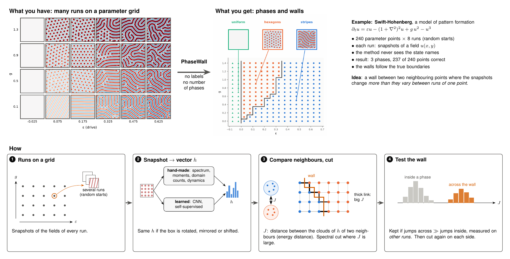
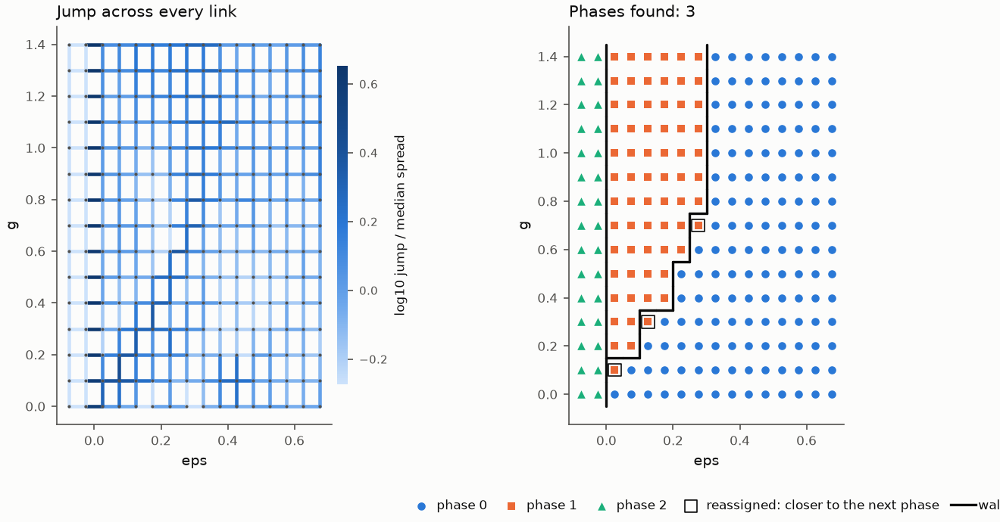

# PhaseWall

[](https://github.com/Lu-Dumoulin/PhaseWall/actions/workflows/tests.yml)

PhaseWall finds the phases of a simulated system. It uses runs that you already computed on a grid
of parameters. It needs no labels and no number of phases.



## In 30 seconds

- **The idea.** PhaseWall puts a wall between two neighbouring parameter points when their
  snapshots differ more than the runs of one point differ from each other.
- **Input.** Runs on a grid of parameters: 2D snapshots of fields, or 1D kymographs $a(x, t)$, in
  HDF5 or JLD2 files. A field is a scalar, a velocity, a polarity, a nematic tensor or (in 1D) a
  complex amplitude.
- **Output.** The phases and their walls, the points where runs end in different states, the
  observables that change across each wall, and candidate order parameters with a score.
- **How.** Four steps: describe each snapshot, compare neighbouring points, cut the grid, test
  each cut on runs that did not place it.
- **Tools.** A command line (`phasewall`), a Python package and an interactive page in the
  browser ([marimo](https://marimo.io)).

More: [two-page summary](docs/TLDR.pdf) and the full [documentation](docs/documentation.pdf)
(mathematics, a physics parallel for each step, tests).

## Example: the Swift-Hohenberg equation

$$\partial_t u = \varepsilon u - (1 + \nabla^2)^2 u + g u^2 - u^3$$

This model of pattern formation has three states in 2D: uniform ($\varepsilon < 0$), hexagons of
spots (small $\varepsilon > 0$, $g > 0$) and stripes. `phasewall demo` simulates
$16 \times 15$ points $(\varepsilon, g)$ with 8 runs each from random initial conditions (1920
runs to $t = 5000$, about eight minutes on 8 cores). It describes the last 6 snapshots of each
run and finds the walls.

One snapshot from the middle of each phase found:


Left: the jump across each link of the grid. Middle: the phases and their walls. Right: the
state of each point measured directly, which PhaseWall never sees.



- **Phases.** PhaseWall finds 3 phases. 236 of 240 points carry the most common label of their
  phase. The 4 other points are on the hexagon-stripe boundary, where the 8 runs end in different
  states.
- **Robust.** The result stays at 3 phases for the threshold `RATIO` from 1.2 to 2.
- **Order parameters.** PhaseWall then looks for one descriptor and one threshold that separate
  each pair of phases. It counts the share of points on the correct side, on runs that did not
  choose the threshold. Hexagons against stripes: the skewness of $u$ (98 %). Uniform against
  the rest: the variance of $u$ (100 %).

The same method finds the phases of four other 2D models and of a 1D model (the complex
Ginzburg-Landau equation). See [Examples](docs/examples.md).

## Install

1. Install Python 3.11 or newer.
2. Clone the repository and open its folder.
3. Make an environment and install PhaseWall:

```bash
python3 -m venv .venv && source .venv/bin/activate
pip install -e ".[dev]"
```

Optional extras: `nn` (learned description, PyTorch), `baselines` (comparisons, scikit-learn),
`app` (the interactive page, with both).

## Quick start

```bash
phasewall demo data/quick --quick     # a small Swift-Hohenberg scan, a few seconds
phasewall demo data/demo              # the example above, about eight minutes
./explore.sh                          # the interactive page in the browser
```

With your own runs:

1. Run `phasewall inspect FILE` on one snapshot file. It lists the datasets and suggests the
   fields.
2. Write a TOML file that describes the ensemble (or let the interactive page write it).
3. Run `phasewall describe ensemble.toml`, then `phasewall walls descriptors.csv --config ensemble.toml`.

See [Usage](docs/usage.md) for the TOML file, 1D runs, the outputs and the interface.

## How it works

1. **Describe.** Each snapshot becomes a vector of numbers. A rotation, a mirror or a shift of the
   box does not change them: amplitude, structure factor $S(k)$, moments, number of domains,
   global order, divergence and curl, and the change between two snapshots. A learned encoder
   (a CNN trained without labels) can replace or complete this description.
2. **Compare.** The runs at one point form a sample. The jump $J$ of a link between two
   neighbouring points is the energy distance between their samples. It is zero only for equal
   distributions.
3. **Cut.** A random walk on the grid rarely crosses large jumps. Its slowest mode (the Fiedler
   vector) orders the points across the strongest barrier. PhaseWall cuts where the normalised cut
   is smallest.
4. **Test.** PhaseWall places each cut with one half of the runs and tests it with the other half.
   A cut is a wall when its crossing links jump more than the inner links: Mann-Whitney
   $p < 10^{-3}$ and a ratio of medians of at least 1.5. Then it cuts each side again.

The test on the other half removes the selection bias: tested on the same runs, the cuts gave
false walls in 24 of 40 tables of pure noise; tested on the other half, in 0 of 40.

After the cuts, PhaseWall joins two parts of one phase that another phase separates, flags the
points whose runs end in different states, and moves single points near a wall to the phase they
resemble. A threshold tree gives the phases as rules on single descriptors, such as "variance
of $u$ at its floor" for the uniform state. See [Method](docs/method.md).

## Results

ARI: adjusted Rand index against known states (1: the same partition, 0: chance). Hand-made
description, default settings.

| example | points x runs | walls | best blind method |
| --- | --- | --- | --- |
| Swift-Hohenberg | 240 x 8 | 3 phases, ARI 0.94 | HDBSCAN, 0.78 (20 % of runs left as noise) |
| Gray-Scott | 525 x 4 | 8 phases, 0.95 | k-means, 0.99 (23 pieces on the grid) |
| localised Swift-Hohenberg | 105 x 4 | 3 phases, 1.00 | HDBSCAN, 1.00 (13 % noise) |
| Barkley | 165 x 4 | 2 phases, 0.58 | HDBSCAN, 0.84 (14 % noise) |
| FitzHugh-Nagumo | 99 x 4 | 1 phase | HDBSCAN, 0.71 (23 % noise) |
| 1D Ginzburg-Landau | 126 x 4 | 4 phases, 0.80 | HDBSCAN, 0.63 (9 % noise) |

- When each parameter point ends in one state, the walls agree with the known states at 95 to
  100 % of the points, and give connected regions.
- Barkley and FitzHugh-Nagumo fail for a known reason: at many points the runs end in different
  states, so the spread of a point is as large as the jumps.

Details, figures and the learned description: [Examples](docs/examples.md).

## More documentation

- [Method](docs/method.md): the descriptions, the walls, the tree, order parameters, blind methods.
- [Examples](docs/examples.md): all results, the comparison of descriptions and methods.
- [Usage](docs/usage.md): the TOML file (2D and 1D), the command line, the outputs, the interface.
- [Development](docs/development.md): tests, code layout, how to add an encoder or a method.
- [References](docs/references.md).
- [Documentation (PDF)](docs/documentation.pdf): the full mathematics and every choice.

## Tests

1. Run `pip install -e ".[dev]"` once.
2. Run `pytest -q` (283 tests, about two minutes).

Every test uses small synthetic data with a known answer. The tests with PyTorch, scikit-learn or
marimo are skipped when the extra is not installed. See [Development](docs/development.md).

## Next steps

- **Predictive learned description (JEPA), being tested.** The contrastive encoder learns to
  recognise each run. On static patterns this gives the phases. On dynamic systems it does not:
  the encoder recognises a run by details that the initial noise sets (a wavenumber, a position),
  not by its state. JEPA hides parts of a window and predicts their description from the rest.
  Nothing in this objective rewards the recognition of a run. On the 1D Ginzburg-Landau equation
  it finds 3 phases where the contrastive encoder finds 1. In 2D the results change with the
  training seed (Gray-Scott: ARI 0.81 or 0, localised Swift-Hohenberg: 1 phase), so it stays an
  option.
- **Several states per point.** Describe each point as a mixture of states (Barkley,
  FitzHugh-Nagumo).
- **Noise with one run per point.** The two time halves of one run are more alike than two runs.
  Use runs at neighbouring points to measure the noise.
- **Power of the test.** Cross-fitting (place with one half, test with the other, then swap)
  could use all runs.
- **Odd fields.** A field rule for systems symmetric under $u \to -u$.
- **Scans that are not grids.** Links between nearest neighbours.

## Acknowledgements

The code, tests and documentation were written by Claude (Anthropic), an AI assistant. The author
designed the method, chose the physics, the examples and the checks, directed the work step by
step and reviewed the results.

## License

MIT.
