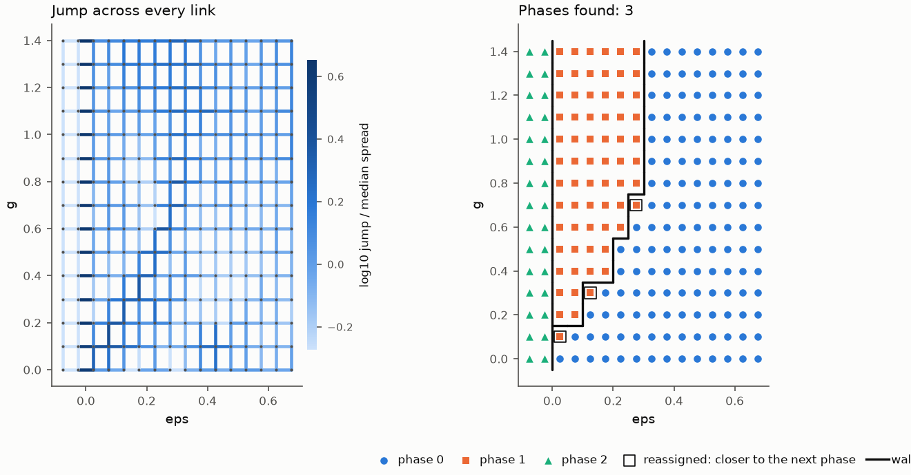
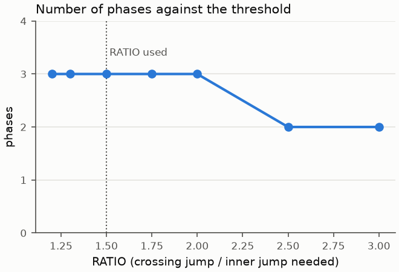
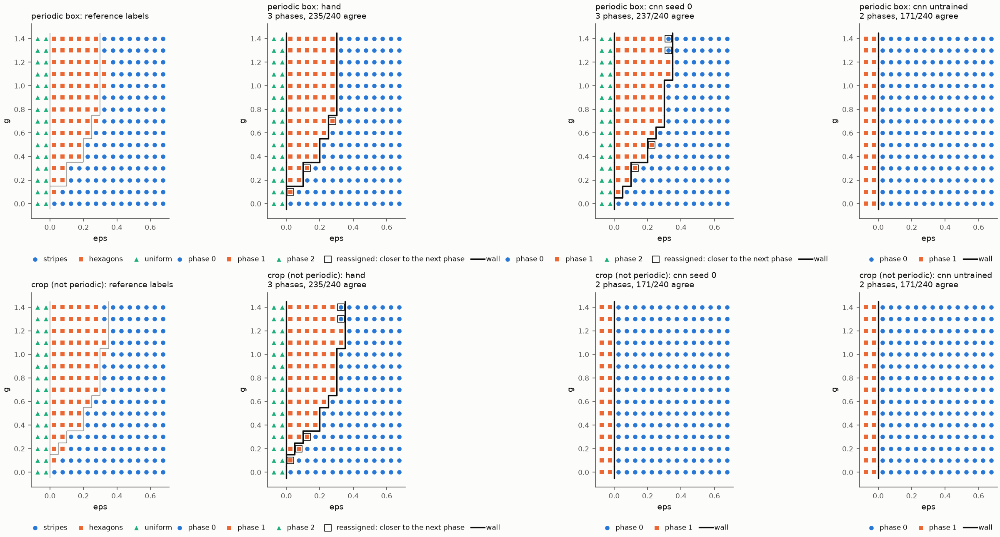
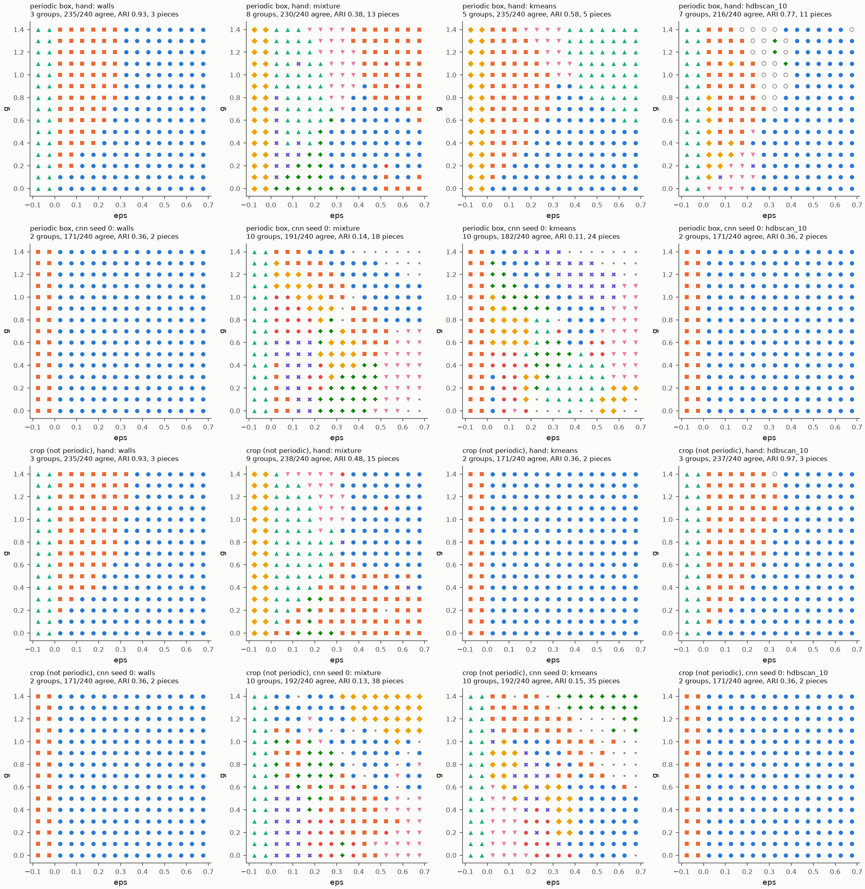
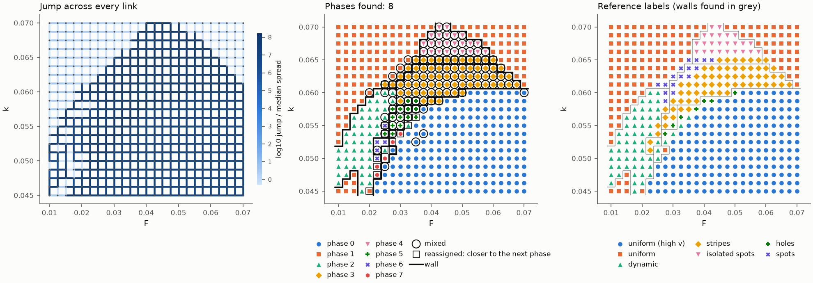
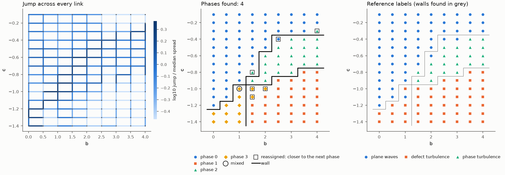
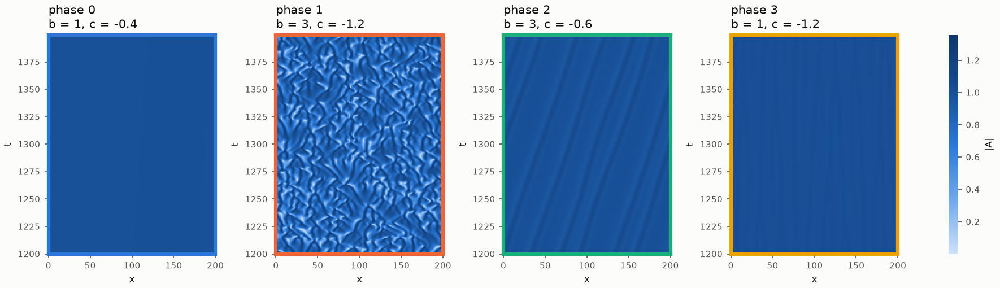

# Examples

Six models with known states. Reference labels come from simple rules on the final snapshots.
PhaseWall never sees them: they are used only for the scores. ARI is the adjusted Rand index on
parameter points (1: the same partition, 0: chance). All runs reach a steady state: 24 runs per
example were continued to 2 and 4 times the run time.

Scripts: `scripts/run_examples.py`, `scripts/tree_examples.py`, `scripts/compare_describers.py`,
`scripts/oned_compare.py`. Outputs: [examples/](examples/overview.md), [comparison/](comparison/summary.md),
[oned/](oned/summary.md).

## All examples

| example | points x runs | walls, hand-made | tree, hand-made | walls, learned | walls, combined | best blind method (hand-made) |
| --- | --- | --- | --- | --- | --- | --- |
| Swift-Hohenberg | 240 x 8 | 3 phases, ARI 0.94 | 3 phases, 0.94 | 3 phases, 0.96 | 3 phases, 0.97 | HDBSCAN 20: 0.78 (20 % noise) |
| Gray-Scott | 525 x 4 | 8 phases, 0.95 | 10 phases, 0.94 | 1 phase | 4 phases, 0.87 | k-means, $k$ = 7: 0.99 |
| localised Swift-Hohenberg | 105 x 4 | 3 phases, 1.00 | 3 phases, 1.00 | 3 phases, 1.00 | 3 phases, 1.00 | HDBSCAN 10: 1.00 (13 % noise) |
| FitzHugh-Nagumo | 99 x 4 | 1 phase | 1 phase | 2 phases, 0.21 | 1 phase | HDBSCAN 20: 0.71 (23 % noise) |
| Barkley | 165 x 4 | 2 phases, 0.58 | 2 phases, 0.58 | 1 phase | 2 phases, 0.58 | HDBSCAN 20: 0.84 (14 % noise) |

- **One state per point.** When each point ends in one state, the walls and the tree agree with the
  known states at 95 to 100 % of the points.
- **Tree rules can be read.** Localised Swift-Hohenberg: the variance of $u$ alone. Gray-Scott: flat
  or not, which uniform state, moving or not, then the shape of $S(k)$.
- **Blind grouping** is sometimes closer (Gray-Scott, k-means), but its groups fall in many pieces
  on the grid (23 for k-means).
- **Barkley.** Rest is separated from activity. Plane waves and spirals are not: at 52 of 165 points
  the runs end in different states.
- **FitzHugh-Nagumo** breaks two assumptions. Its equations are symmetric under $u \to -u$, but the
  descriptors are not, so uniform runs at $u \approx \pm 0.71$ look like two states. And at 48 of 99
  points the runs end in different states.

## Swift-Hohenberg

$\partial_t u = \varepsilon u - (1 + \nabla^2)^2 u + g u^2 - u^3$, $16 \times 15$ points, 8 runs each,
$t = 5000$.

- The 4 points that disagree are on the hexagon-stripe boundary. Their 8 runs end in different
  states, often with spots and stripes side by side in one box.
- The states are steady: continued to $t = 20\,000$, the patterns change by less than $10^{-5}$.
- 3 phases for `RATIO` from 1.2 to 2; 2 phases (uniform against patterned) from 2.5.

### Hand-made or learned description

Whole periodic box and a centred $40 \times 40$ crop (described as a non-periodic frame).
Relative jump: median jump between a hexagon point and a stripe point, divided by the median of all
jumps. Probe: hexagons against stripes, on held-out points.

| frame | description | phases | points agreeing (of 240) | relative jump | probe |
| --- | --- | --- | --- | --- | --- |
| periodic | hand-made | 3 | 235 | 1.9 | 1.00 |
| periodic | learned, 2 seeds | 3, 3 | 237, 235 | 2.0, 2.0 | 0.99, 1.00 |
| periodic | untrained network | 2 | 171 | 1.1 | 0.93 |
| periodic | learned, old views, 2 seeds | 2, 2 | 171, 171 | 1.4, 1.3 | 0.98, 0.98 |
| crop | hand-made | 3 | 235 | 2.0 | 0.99 |
| crop | learned, 2 seeds | 2, 2 | 171, 171 | 1.8, 1.7 | 0.99, 0.99 |

(Points agreeing are counted on the regions of the cuts, before the merge and the reassignment.)

- **The learned description finds the 3 phases** in the periodic box, for both seeds.
- **Old views** (rotations by $90^\circ$, whole frame, amplitude kept): $h$ held the difference
  (probe 0.98) but changed as much inside a phase as across the boundary. Two causes: a fingerprint
  of each run (the wavevector of the box) and mostly the amplitude.
- **Training is needed.** The untrained network gives 2 phases.
- **Crop.** Still 2 phases. The turned crop must stay inside the frame, so the network sees only 22 of
  the 40 points.
- **Choosing views without labels does not work.** The old views have the lower loss, because easier
  views give a lower loss.

### Walls against blind grouping

| frame | description | method | groups | points agreeing | ARI | pieces | noise |
| --- | --- | --- | --- | --- | --- | --- | --- |
| periodic | hand-made | walls | 3 | 236 | 0.94 | 3 | 0 |
| periodic | hand-made | Gaussian mixture | 8 | 230 | 0.38 | 13 | 0 |
| periodic | hand-made | k-means ($k$ = 7) | 5 | 235 | 0.58 | 5 | 0 |
| periodic | hand-made | HDBSCAN 10 | 7 | 216 | 0.77 | 11 | 12 % |
| crop | hand-made | walls | 3 | 238 | 0.97 | 3 | 0 |
| crop | hand-made | HDBSCAN 20 | 3 | 237 | 0.97 | 3 | 4 % |
| periodic | learned | walls | 3 | 237 | 0.96 | 3 | 0 |
| periodic | learned | HDBSCAN 20 | 4 | 117 | 0.90 | 7 | 44 % |

The probe recognises the three states in more than 99 % of held-out snapshots with every
description, so every description contains the states. The blind methods fail because the hexagon
and stripe clouds touch and drift with the parameters.

## Gray-Scott

Reaction-diffusion (fields $u$, $v$; parameters $F$, $k$; Pearson 1993): two uniform states, spots,
isolated spots, holes, stripes and labyrinths, moving states. Grid steps 0.0025 and 0.00125,
$t = 40\,000$.

- 8 phases, ARI 0.95. The uniform state lies in three places; PhaseWall joins them into one phase.
- On a grid twice as coarse, the pattern band (1 to 3 points wide) was merged with a uniform state.
- The learned description finds 1 phase: part of the difference is the mean value of the fields,
  which the normalisation of the views removes.

## Localised Swift-Hohenberg

Cubic-quintic: $\partial_t u = \varepsilon u - (1 + \nabla^2)^2 u + b u^3 - u^5$. Stripe patches stay
localised in the pinning range of homoclinic snaking, vanish below it and invade the box above.
Walls, tree and learned description: 3 phases, ARI 1.00.

## Barkley

Excitable medium ($a$, $b$ at $\varepsilon = 0.02$, $t = 4000$): rest, plane wave trains, spirals.
Walls: rest against activity (ARI 0.58). Plane waves and spirals are not separated.

## FitzHugh-Nagumo

Hagberg-Meron form, symmetric bistable medium ($\varepsilon$, $\delta$): fronts, moving domains,
front turbulence, uniform states, labyrinths. Walls: 1 phase (see above for why).

## 1D: the complex Ginzburg-Landau equation

$\partial_t A = A + (1 + ib)\,\partial_x^2 A - (1 + ic)\lvert A \rvert^2 A$ on a grid of $(b, c)$: 126 points,
4 runs each (17 s to simulate on 8 cores). Regimes: plane waves, phase turbulence past the
Benjamin-Feir line, defect turbulence with phase slips.

| description | walls | ARI | best blind method |
| --- | --- | --- | --- |
| hand-made | 4 phases, 122/126 points agree | 0.80 | HDBSCAN 10, 0.63 (9 % noise) |
| learned, contrastive, 2 seeds | 1 phase | 0 | HDBSCAN 20, 0.96 and 1.00 (31 and 45 % noise) |
| learned, predictive (JEPA), 2 seeds | 3 phases | 0.63, 0.74 | tree, 3 phases, 0.92 (seed 0) |
| combined (hand-made + JEPA) | 4 phases | 0.83 | HDBSCAN 20, 0.79 |

- **The fourth phase** is on the stable side of the Benjamin-Feir line at large $\lvert c \rvert$:
  laminar plane waves cut by turbulent bursts (spatiotemporal intermittency, Chaté 1994). The
  reference labels count it as defect turbulence.
- **Through $\lvert A \rvert$.** Described through $A$, each plane wave looked like a new state
  (the initial noise sets its wavenumber), and the walls found 1 phase.
- **Contrastive encoder.** It holds the regimes (probe 0.94) but jumps across a boundary only 1.4
  times its inner jumps (hand-made 2.4). It recognises each run by its wavenumber.
- **JEPA** rewards nothing of the kind and finds 3 phases. Each seed joins two of the four regimes,
  not the same two.
