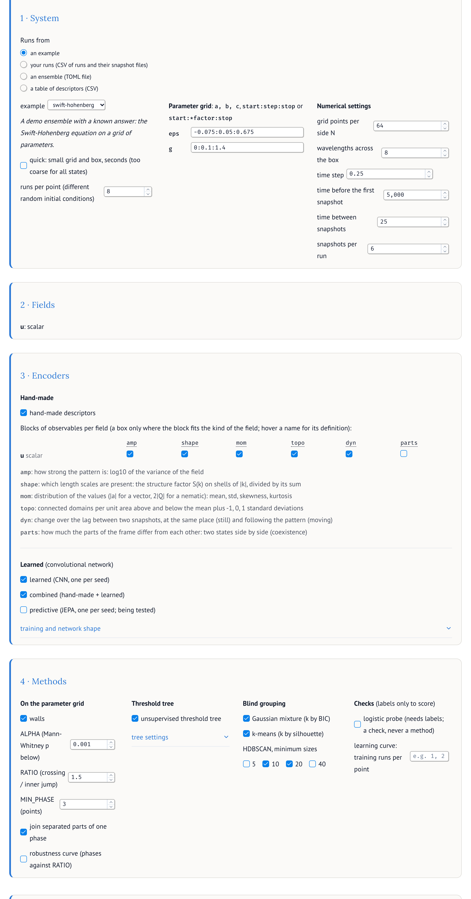
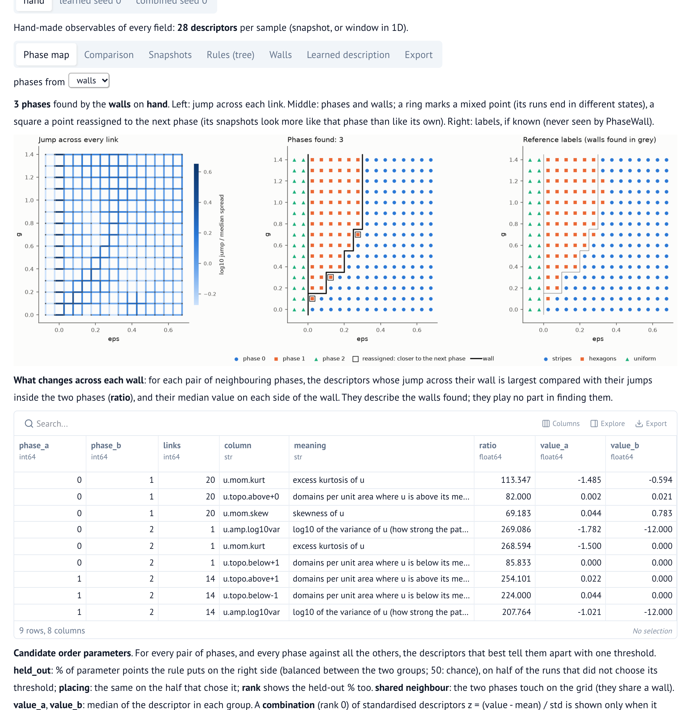
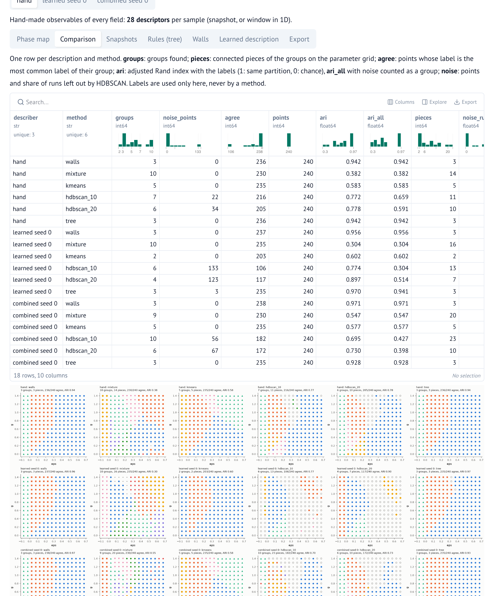

# Usage

## Install

```bash
python3 -m venv .venv && source .venv/bin/activate
pip install -e ".[dev]"            # add nn, baselines or app as needed
```

| extra | adds | for |
| --- | --- | --- |
| `nn` | PyTorch | the learned description |
| `baselines` | scikit-learn | blind grouping, probe |
| `app` | marimo, PyTorch, scikit-learn | the interactive page |

## Your own 2D runs

1. Run `phasewall inspect run0/Data/0000001000.jld2` on one snapshot file. It lists the datasets
   (name, shape, type) and suggests `[[fields]]` blocks. It groups components saved apart (`vx`,
   `vy`; `Qxx`, `Qxy`) into one field. Names suggest a role (`v`: velocity, `p`: polarity, `Q`:
   nematic). Check every suggestion.
2. Write the TOML file of the ensemble:

```toml
[ensemble]
runs = "runs.csv"              # one row per run: a column `path`, one column per parameter
parameters = ["rho0", "zeta"]
snapshots = "Data/*.jld2"      # snapshot files inside each run folder
time_regex = '(\d+)\.jld2$'    # the time is the number in the file name
julia_order = true             # arrays written by Julia (column-major)
dx = 0.01                      # or a column `dx` in runs.csv
last = 10                      # the last 10 snapshots of each run are described
pair_dt = 1000.0               # time between the two snapshots of a pair (dynamics)
periodic = true
# optional frame (needed when boxes or grids differ between runs)
crop = 5.0                     # side of a centred square
dx_target = 0.02               # coarsen to this grid spacing (a multiple of dx)
max_shift = 1.0                # moving correlation: shifts up to this

[[fields]]
name = "rho"
keys = ["C", "rho"]            # names it can have in the files
kind = "scalar"                # scalar, velocity, polarity, vector or nematic
relative = true                # describe (rho - <rho>) / <rho>

[[fields]]
name = "p"
keys = ["P"]                   # one dataset with both components
kind = "polarity"
blocks = ["amp", "shape", "defects"]   # optional: the observables (default: by kind)

[[fields]]
name = "v"
components = ["vx", "vy"]      # two datasets, stacked as (x, y)
kind = "velocity"
```

3. Describe and find the walls:

```bash
phasewall describe ensemble.toml --workers 4     # -> descriptors.csv, one row per snapshot
phasewall walls descriptors.csv --config ensemble.toml
```

Rules:

- Unknown keys are errors.
- A scalar named like a component (`vx`, `Qxx`) is refused: one component alone is not invariant
  under rotations. Add `single_component = true` if it is a scalar of its own.
- A vector or nematic field whose fluctuations are below $10^{-3}$ of its size counts as uniform.

## Your own 1D runs

A 1D ensemble uses a `[kymograph]` section. With one HDF5 or JLD2 file per run, `file = ""` tells
PhaseWall that the column `path` gives the file of each run.

```toml
[kymograph]
runs = "runs.csv"              # a column `path` (the file of the run), one column per parameter
parameters = ["b", "c"]
file = ""                      # or a file name inside each run folder
julia_order = true
order = "xt"                   # axes of an array once read: "xt" or "tx"
dx = 0.78
dt = 0.5                       # time between two rows
periodic = true
share = 0.5                    # the last half of each run is described ...
windows = 8                    # ... cut into 8 windows, one row of the table each

[[fields]]
name = "A"
kind = "complex"               # scalar, velocity, polarity or complex
components = ["Are", "Aim"]
```

The interactive page writes this file for you (choose 1D, then "your runs"): it reads the first
file, groups pairs of datasets (`Are` and `Aim` as a complex amplitude, `px` and `py` as a
polarity), guesses the order of the axes (the longer one is time), and draws the kymograph so that
you can check the order.

## Learned description

```bash
phasewall learn ensemble.toml                     # -> encoder/descriptors_cnn.csv
phasewall learn ensemble.toml --objective jepa    # predictive description, being tested
phasewall learn ensemble.toml --blocks 3 --dim-h 128 --projection 32   # another shape, checked first
phasewall walls encoder/descriptors_cnn.csv --config ensemble.toml
phasewall describe other.toml --encoder encoder   # the trained encoder on another ensemble
```

Shapes are compared without labels, by the loss, the alignment, the uniformity and the effective
rank of $h$, never by scores, which would bring the labels back in.

## Outputs of `phasewall walls`

A folder with:

- `summary.md`: the phases, walls, mixed points, reassigned points, and the two tables below;
- `nodes.csv`: one row per parameter point (region, phase, flags);
- `edges.csv`: one row per link (jumps, wall or not);
- `cuts.csv`, `robustness.csv`;
- `wall_observables.csv`: per pair of neighbouring phases, the descriptors that change most
  across their wall;
- `order_parameters.csv`: candidate order parameters with their held-out score;
- figures: `phase_map.png`, `robustness.png`, `snapshots.png` (or `kymographs.png` in 1D).

`walls` reads any table with one row per snapshot and columns named `field.block.name`
(`--parameters` instead of `--config`).

## Interactive interface

```bash
./explore.sh            # the page in the browser
./explore.sh --edit     # the same page as a notebook, code visible
./explore.sh -- --1d    # start in 1D
```

The first time, the script makes `.venv` and installs the extra `[app]`. At the top you choose 2D
or 1D. Then one section per step:

1. **System**: an example, your runs (a CSV table of runs), a TOML file, or a table of
   descriptors.
2. **Fields**: the datasets of the first file, with suggested fields. You confirm each kind. In
   1D you also choose the order of the axes.
3. **Encoders**: hand-made (a grid of blocks per field), learned (the network is checked before
   training), combined.
4. **Methods**: walls, tree, Gaussian mixture, k-means, HDBSCAN, probe.
5. **Frame** (2D) or **Windows** (1D): sliders for the crop, the coarsening, the windows.

The run bar shows where each step runs (CPU cores or GPU), an estimate of its time, and the time
of an alternative. Every step is cached.

<p align="center"></p>

The result tabs: phase map (with the wall observables and the order parameters), comparison of
descriptions and methods, snapshots or kymographs of each phase, rules of the tree, details of the
walls, training curves, export.





Details: [apps/README.md](../apps/README.md).
